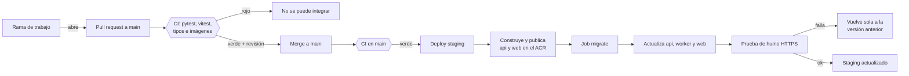

# Despliegue en staging (Azure Container Apps)

Guía para integrar cambios, desplegarlos y operar el ambiente de **staging** de ComplianceIA, que es el que usan los usuarios del piloto (HU-14). Todo lo que aparece aquí se puede repetir: los mismos pasos dan el mismo resultado.

| | |
|---|---|
| **URL de staging** | `https://web.blackstone-2434d7b1.northcentralus.azurecontainerapps.io` |
| **Grupo de recursos** | `rg-complainceia` (West US 3; solo guarda metadatos) |
| **Registro de imágenes** | `acrcomplainceia.azurecr.io` (West US 3) |
| **Cómputo, base de datos y archivos** | North Central US: entorno `cae-complianceia`, apps `web`, `api`, `worker`, `redis`, jobs `migrate` y `seed`, PostgreSQL Flexible Server `pg-complianceia-11539`, cuenta `stcompl257927337` |
| **Suscripción** | Azure for Students |
| **Workflows** | `.github/workflows/ci.yml` y `.github/workflows/deploy-staging.yml` |

> **Por qué `APP_ENV=production` en staging.** `APP_ENV` no indica en qué ambiente estamos: activa las validaciones de seguridad (claves obligatorias, anonimización encendida, sin modos de depuración). Staging tiene que comportarse igual que producción, así que usa `production`.

---

## 1. Cómo funciona



| Workflow | Cuándo corre | Qué hace |
|---|---|---|
| **CI** (`ci.yml`) | En cada pull request a `main`, en cada push a `main` y a mano | `backend`: pytest con cobertura ≥ 70 %. `frontend`: TypeScript + vitest. `imagenes`: construye las imágenes `api` y `web` **sin publicarlas** y revisa que no tengan secretos. `CI aprobado`: un solo check con el resultado de todo |
| **Deploy staging** (`deploy-staging.yml`) | Solo, cuando CI termina **en verde** después de un push a `main`; y a mano | Construye y publica `api:<commit>` y `web:<commit>`, ejecuta `migrate`, actualiza `api`, `worker` y `web`, hace la prueba de humo y, si algo falla, vuelve a la versión anterior |

Las pruebas corren en los servidores de GitHub. Nadie tiene que ejecutar nada en su computador, y `git pull` no dispara nada. En un pull request solo corren los jobs de la parte que cambió: un PR que solo toca el frontend no espera a pytest.

La lógica del despliegue está en `.github/scripts/desplegar_staging.sh`. Es el mismo script que se puede correr a mano desde Azure Cloud Shell (sección 5.3).

---

## 2. Preparación inicial (una sola vez)

Se hace desde **Azure Cloud Shell** (portal de Azure > icono `>_` > Bash), que ya trae Azure CLI, jq y git. No hacen falta scripts de Windows.

```bash
git clone https://github.com/jerReyDuoc/Capstone.git && cd Capstone

# Datos del administrador del piloto: quedan como SECRETOS del job seed
export SEMILLA_ADMIN_EMAIL=admin@therionlabs.cl
export SEMILLA_ADMIN_PASSWORD='una-clave-larga-y-unica'      # 12+ caracteres
# Opcional: para revisar los permisos de la identidad de GitHub Actions
export AZURE_CLIENT_ID=<valor del secreto API_AZURE_CLIENT_ID>

bash Proyecto/infra/azure/preparar_staging.sh                  # agrega --asignar-roles si faltan permisos
```

El script `Proyecto/infra/azure/preparar_staging.sh`:

1. Comprueba que existan el grupo de recursos, el registro, las apps y el job `migrate`.
2. Revisa que la identidad de GitHub Actions tenga **Contributor** en `rg-complainceia` y **AcrPush** en `acrcomplainceia`. Con `--asignar-roles` crea los permisos que falten (requiere ser Owner de la suscripción).
3. Crea (o actualiza) el **job `seed`** de datos semilla:
   - del job `migrate` copia el entorno, el perfil de carga de trabajo, la identidad y el acceso al registro;
   - de la app `api` copia las variables y los secretos, así que usa el rol limitado `complianceia_app` y no el dueño de la base;
   - el correo y la clave del administrador quedan como secretos del job.
4. Deja el `worker` con exactamente 1 réplica (las tareas programadas no se duplican) y la `web` solo por HTTPS.
5. Muestra la configuración que debe tener GitHub.

### 2.1 Configuración en GitHub

*Settings > Secrets and variables > Actions*

| Tipo | Nombre | Valor |
|---|---|---|
| Secreto | `API_AZURE_CLIENT_ID`, `API_AZURE_TENANT_ID`, `API_AZURE_SUBSCRIPTION_ID` | Ya existen (los creó el portal). Son de la identidad OIDC: **no son contraseñas** |
| Secreto (opcional) | `API_REGISTRY_USERNAME`, `API_REGISTRY_PASSWORD` | Ya existen. Si se borran, el workflow publica las imágenes con la identidad OIDC (necesita AcrPush) |
| Variable (opcional) | `AZ_RESOURCE_GROUP` | `rg-complainceia` |
| Variable (opcional) | `AZ_ACR_NAME` | `acrcomplainceia` |
| Variable (opcional) | `MIGRACIONES_AUTOMATICAS` | `true` (por defecto). `false` = el despliegue automático no ejecuta `migrate` |
| Variable (opcional) | `SEMBRAR_AL_DESPLEGAR` | `false` (por defecto). `true` = ejecuta `seed` en cada despliegue (es idempotente) |

Los secretos `WEB_AZURE_*` y `WEB_REGISTRY_*` eran de los workflows que creó el portal y ya no se usan.

> **Identidad OIDC.** La credencial federada que creó el portal confía en la rama `main` (`repo:jerReyDuoc/Capstone:ref:refs/heads/main`). Por eso el despliegue **no usa *environments* de GitHub**: con ellos el sujeto del token cambia a `environment:<nombre>` y el inicio de sesión en Azure fallaría hasta agregar otra credencial federada.

---

## 3. Proteger la rama `main` (obligatorio para el criterio 1)

Lo hace alguien con permiso de administrador del repositorio. *Settings > Branches > Add branch ruleset* (o *Add classic branch protection rule*) para `main`:

1. **Require a pull request before merging**, con 1 aprobación.
2. **Require status checks to pass** y elegir **`CI aprobado`**. Aparece en la lista después de la primera ejecución del workflow CI.
3. **Require branches to be up to date before merging** (recomendado).
4. Opcional: **Do not allow bypassing the above settings**.

Desde ahí nadie puede subir directo a `main` ni integrar un pull request con las pruebas en rojo.

---

## 4. Flujo de trabajo del equipo

```bash
git switch main && git pull                 # traer lo último
git switch -c hu-23-pipeline                # una rama por historia o arreglo
# ... cambios ...
git add -A && git commit -m "Pipeline de CI y despliegue a staging"
git push -u origin hu-23-pipeline           # luego en GitHub: "Compare & pull request"
```

1. En el pull request aparece **CI aprobado** con ✅ o ❌ a los pocos minutos. El detalle de cada job (cobertura, pruebas, imágenes) está en la pestaña *Checks*.
2. Con ✅ y la revisión de un compañero se hace **Merge**.
3. El merge corre CI en `main` y, si queda en verde, **Deploy staging** publica la versión en unos 10–15 minutos. El resumen del run muestra la URL, la etiqueta y la versión anterior.

---

## 5. Despliegues a mano

*Actions > Deploy staging > Run workflow* (rama `main`):

| Campo | Para qué |
|---|---|
| **Etiqueta** | Vacío = construye y despliega el commit actual de `main`. Con un valor (un SHA ya publicado) despliega esa versión sin construir: sirve para **volver atrás** |
| **Ejecutar las migraciones** | Marcado por defecto |
| **Cargar los datos semilla** | Ejecuta el job `seed` antes de actualizar las apps |

### 5.1 Datos semilla

El job `seed` ejecuta `python scripts/sembrar_staging.py`, que:

- crea el **administrador** (`SEMILLA_ADMIN_EMAIL` / `SEMILLA_ADMIN_PASSWORD`). Si ya existe no lo toca;
- crea **20 evaluaciones completadas de ejemplo**: 10 en cada uno de los dos primeros rubros del catálogo. Son totalmente sintéticas: sin correos, nombres ni textos personales, con IDs desde 990001. Así la comparativa sectorial se ve desde el primer día, porque se oculta mientras un rubro tenga menos de 5 organizaciones;
- recalcula el benchmark.

Es **idempotente**: correrlo varias veces no duplica nada. Opciones (variables del job o argumentos):

| Opción | Variable | Defecto |
|---|---|---|
| `--rubros N` | `SEMILLA_RUBROS` | 2 |
| `--por-rubro N` | `SEMILLA_POR_RUBRO` | 10 |
| `--sin-evaluaciones` | — | solo el administrador |
| `--actualizar-clave` | — | cambia la clave de un administrador que ya existe |
| `--eliminar` | `SEMILLA_ACCION=eliminar` | borra las evaluaciones de ejemplo y recalcula el benchmark |

> **Antes de medir los resultados reales del piloto (HU-14), elimina los datos de ejemplo** para que no se mezclen con la comparativa real. Desde Cloud Shell:
>
> ```bash
> az containerapp job update -n seed -g rg-complainceia --set-env-vars SEMILLA_ACCION=eliminar
> az containerapp job start  -n seed -g rg-complainceia      # esperar "Succeeded" en el historial
> az containerapp job update -n seed -g rg-complainceia --set-env-vars SEMILLA_ACCION=sembrar
> ```
>
> El último comando deja el job como estaba, para que un despliegue con datos semilla no vuelva a borrarlos.

Los catálogos (dominios, rubros, 40 controles, filtro F1–F7, módulos de formación) **no** vienen de este script: los cargan las migraciones de Alembic.

En local (Docker Compose) se usa igual:

```bash
docker compose exec -e SEMILLA_ADMIN_EMAIL=admin@ejemplo.cl \
  -e SEMILLA_ADMIN_PASSWORD='clave-local-de-prueba' api python scripts/sembrar_staging.py
```

### 5.2 Cambiar o agregar un secreto de la aplicación

Los secretos viven **solo** en Azure, como secretos de cada Container App. Nunca van en el repositorio ni en la imagen. Por ejemplo, para cambiar la clave de Groq:

```bash
az containerapp secret set -n api -g rg-complainceia --secrets groq-api-key='<nueva>'
az containerapp secret set -n worker -g rg-complainceia --secrets groq-api-key='<nueva>'
az containerapp revision restart -n api -g rg-complainceia \
  --revision "$(az containerapp show -n api -g rg-complainceia --query properties.latestRevisionName -o tsv)"
```

El nombre del secreto (`groq-api-key` en el ejemplo) es el que aparece en *Aplicación > Secretos* de cada app. Si cambias un secreto de `api`, corre de nuevo `preparar_staging.sh` para que el job `seed` reciba el valor nuevo.

### 5.3 Desplegar desde Cloud Shell, sin GitHub

Sirve si GitHub Actions no está disponible. Hace exactamente lo mismo que el workflow:

```bash
cd Capstone && git pull
TAG=$(git rev-parse HEAD)
az acr build -r acrcomplainceia -t api:$TAG Proyecto/backend
az acr build -r acrcomplainceia -t web:$TAG --build-arg API_URL=http://api Proyecto/frontend-next
bash .github/scripts/desplegar_staging.sh $TAG        # MIGRAR=false o SEMBRAR=true según el caso
```

`az acr build` construye la imagen en Azure; no hace falta Docker en el PC. Algunas suscripciones con crédito gratuito o de estudiante tienen ACR Tasks bloqueado (error `TasksOperationsNotAllowed`). En ese caso, construye con `docker build` + `docker push` en un PC con Docker (después de `az acr login -n acrcomplainceia`), o usa el workflow.

---

## 6. Volver a una versión anterior

- **Automático:** si la revisión nueva de `api`, `worker` o `web` no queda sana, o si la prueba de humo falla, el script vuelve las tres apps a las imágenes que corrían antes. El run queda en rojo y el resumen lo indica.
- **A mano:** *Actions > Deploy staging > Run workflow* con la **etiqueta** de la versión buena, que aparece en el resumen de un despliegue anterior o en `az acr repository show-tags -n acrcomplainceia --repository api --orderby time_desc -o table`. Desmarca *Ejecutar las migraciones* si la versión anterior no conoce el esquema nuevo.
- **Base de datos:** las migraciones **no se revierten solas**. Por eso cada migración debe ser compatible con la versión anterior del código (agregar columnas o tablas, no borrarlas en el mismo cambio). Si hiciera falta, PostgreSQL Flexible Server permite una **restauración a un punto en el tiempo** (*Información general > Restaurar*). Crea un servidor nuevo, así que después hay que apuntar los secretos `DATABASE_URL*` a ese servidor.

---

## 7. Dónde vive cada secreto

| Secreto | Dónde | Quién lo usa |
|---|---|---|
| `DATABASE_URL`, `DATABASE_URL_SYNC` (rol `complianceia_app`) | Secretos de `api`, `worker` y `seed` | La aplicación |
| `DATABASE_URL*` del dueño (`pgadmin`) | Secretos de `migrate` | Solo las migraciones |
| `DB_APP_PASSWORD`, `AUTH_SECRET`, `BFF_SHARED_SECRET`, `ENTITY_MAP_KEY`, `GROQ_API_KEY`, `TURNSTILE_SECRET_KEY`, `SMTP_PASSWORD` | Secretos de cada Container App que los necesita | La aplicación |
| `SEMILLA_ADMIN_EMAIL`, `SEMILLA_ADMIN_PASSWORD` | Secretos del job `seed` | Datos semilla |
| `API_AZURE_*` (OIDC) | Secretos del repositorio en GitHub | El workflow, para iniciar sesión en Azure |
| `API_REGISTRY_*` | Secretos del repositorio en GitHub (opcionales) | El workflow, para publicar imágenes |

**La imagen no lleva secretos.** Los `.dockerignore` excluyen `.env`, y el CI lo comprueba en cada pull request con `.github/scripts/verificar_imagen.sh`, que revisa tres cosas:

- que no haya archivos `.env` dentro de la imagen;
- que no haya variables con nombre de secreto que traigan un valor;
- que el historial de capas no muestre secretos.

Para revisarlo a mano:

```bash
docker build -t api:local Proyecto/backend && bash .github/scripts/verificar_imagen.sh api:local
```

---

## 8. Verificación (QA) de los criterios de aceptación

| # | Criterio | Cómo se verifica | Evidencia |
|---|---|---|---|
| 1a | El pipeline corre pytest en cada PR | Abrir un PR que rompa una prueba a propósito (por ejemplo, cambiar un `assert`) | Captura del PR con **CI aprobado ❌** y el botón *Merge* bloqueado |
| 1b | Construye la imagen en cada PR | En el mismo PR, job **Imagen api** y **Imagen web** en verde. Un PR con un error en un Dockerfile queda en rojo | Captura de la pestaña *Checks* |
| 1c | Solo se integra con todo en verde | Revertir el cambio: **CI aprobado ✅** y *Merge* habilitado | Captura de la regla de protección de `main` |
| 2a | HTTPS | `curl -sSI https://<url>/` responde `200` con `strict-transport-security`; `curl -sI http://<url>/` redirige a `https://` | Salida de la prueba de humo en el resumen del run |
| 2b | Datos semilla | Iniciar sesión como el administrador sembrado; la comparativa sectorial de los dos primeros rubros muestra el promedio | Captura del panel |
| 2c | Secretos fuera de la imagen | Paso *Revisar que la imagen no lleve secretos* en verde; `docker history` y `docker image inspect` sin valores de secretos | Log del job `imagenes` |
| 3a | Documentado | Esta guía | — |
| 3b | Repetible | Ejecutar *Deploy staging* dos veces con la misma etiqueta: las dos terminan en verde y la semilla no duplica datos | Captura de los dos runs |
| 3c | Vuelve atrás si falla | Desplegar a mano una etiqueta que no exista: falla antes de tocar nada. En una revisión que no arranca, vuelve sola a la anterior | Resumen del run en rojo |

---

## 9. Costos (Azure for Students)

La estimación de la documentación de Azure es de **35 a 55 USD al mes**. Pesan sobre todo PostgreSQL, las réplicas siempre encendidas y Log Analytics. El crédito de Azure for Students es de 100 USD, así que alcanza para unos dos meses:

- crea un **presupuesto** con alertas al 50, 80 y 100 % (*Administración de costos > Presupuestos*);
- el CI no cuesta nada en Azure, porque corre en GitHub y es gratis para repositorios públicos. Cada despliegue suma unos segundos de los jobs `migrate` y `seed` y unos MB en el registro;
- conviene borrar de vez en cuando las imágenes antiguas del ACR (`az acr repository show-tags` + `az acr repository delete`). El plan Basic incluye 10 GB;
- al terminar el proyecto, eliminar el grupo `rg-complainceia` detiene todo el cobro.

---

## 10. Solución de problemas

| Síntoma | Causa probable | Solución |
|---|---|---|
| *Deploy staging* no aparece después del merge | CI en `main` terminó en rojo, o el workflow todavía no está en `main` | Revisar el run de CI en `main`. `workflow_run` solo funciona con el archivo ya integrado en `main` |
| `AADSTS70021: No matching federated identity record` | El sujeto del token no coincide con la credencial federada | Ejecutar desde `main`. No agregar `environment:` al job sin crear antes otra credencial federada |
| `unauthorized: authentication required` al publicar | Faltan los secretos `API_REGISTRY_*` y la identidad no tiene AcrPush | `preparar_staging.sh --asignar-roles` |
| `AuthorizationFailed` al actualizar una app o un job | La identidad no tiene Contributor en el grupo | `preparar_staging.sh --asignar-roles` |
| El job `migrate` termina en `Failed` | Error de la migración o variable faltante (con `production` el backend valida todo al arrancar) | Log Analytics: `ContainerAppConsoleLogs_CL \| where ContainerJobName_s == 'migrate'`. Las apps no se tocaron |
| La revisión de `api` queda en `Failed` y el run vuelve atrás | Falta una variable obligatoria o no conecta a la BD | Registros de `api` (sección 9.1 de la documentación de Azure) |
| La prueba de humo falla en `/health` | `web` no llega a `api` (502) o `api` está detenida | `API_URL=http://api` en la imagen web (lo fija el workflow) y `api` con 1 réplica |
| No existe el job `seed` | No se corrió la preparación inicial | Sección 2 |
| La comparativa no muestra el promedio | Menos de 5 organizaciones en el rubro | Ejecutar `seed`, o esperar al cron diario del benchmark |
| El check **CI aprobado** no aparece para marcarlo obligatorio | CI nunca corrió | Ejecutarlo a mano: *Actions > CI > Run workflow* |
