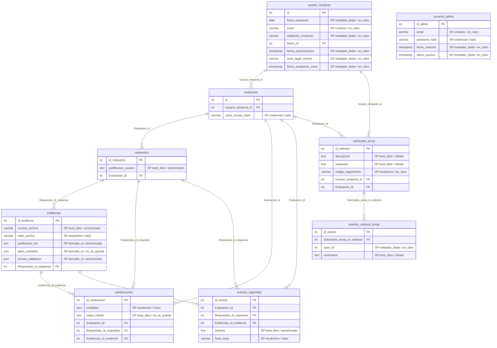

# T-06 — Auditoría de minimización de datos en los modelos de base de datos

> Insumos de la tarea: diagramas entidad-relación, accesos de lectura a esquemas de BD,
> normativas de privacidad y herramientas de gestión SQL.

## Objetivo y alcance

La tarea consiste en comprobar que la base de datos de ComplianceIA guarda solo los datos
personales que necesita, para una finalidad declarada y durante un tiempo acotado, tal como
exigen los principios de finalidad y proporcionalidad del artículo 3 de la Ley 21.719. La
auditoría se hizo sobre el esquema real que producen las 17 migraciones de `main` (commit
`75f217a`, head `e2b7c9d4f8a1`) en PostgreSQL 16, no sobre la documentación, y cubre las 19
tablas y sus 171 columnas.

Cada insumo de la tarea quedó cubierto así. El **acceso de lectura** es un rol nuevo de
PostgreSQL, `auditor_t06`, que solo puede leer: sus sesiones son de solo lectura, no puede
crear objetos, su clave vence y la auditoría nunca se hace con el usuario `postgres` que usa
la aplicación. Las **herramientas SQL** son `psql` y DBeaver (el rol sirve para conectarse
desde ahí en `localhost:5433`) y un script que corre las consultas dentro de una transacción
de solo lectura. Los **DER** los genera ese mismo script desde el esquema real: uno completo
y otro reducido a las tablas con datos personales, con cada columna marcada según su
categoría. La **normativa** está en el inventario: cada columna con datos personales declara
su finalidad, su base de licitud y su plazo de conservación.

## Cómo se hizo

Primero se construyó un inventario en código, `app/core/catalogo_datos_personales.py`, que
clasifica cada una de las 171 columnas. Se eligió código y no una planilla porque una
planilla queda obsoleta con la primera migración nueva; en cambio, la prueba
`test_toda_columna_del_modelo_esta_clasificada_y_nada_sobra` falla si alguien agrega una
columna sin clasificarla. El criterio para decidir qué es dato personal fue que identifique o
permita identificar a una persona natural: las respuestas y puntajes describen a la
organización evaluada y quedaron fuera, mientras que correos, credenciales, fechas de
consentimiento y todo texto libre que escriba un titular quedaron dentro.

Después, `scripts/auditoria_minimizacion.py` cruza ese inventario con el esquema de
PostgreSQL y revisa el contenido de las columnas según cómo deberían estar: en las de texto
anonimizado busca RUT (validando el dígito verificador), correos y teléfonos en claro; en las
cifradas comprueba que todo valor lleve el prefijo `enc:v1:`; y en las que no deben guardarse
cuenta los valores que no son NULL. Usa detectores propios y no el motor NER del sistema,
porque una auditoría no debería depender solo de la pieza que audita. Nunca imprime valores,
solo conteos.

Por último se revisó el código que escribe cada columna sensible (casos de uso, repositorios y
el worker) para encontrar caminos en que un dato se guarde sin finalidad o no se borre cuando
corresponde.

## Resultado del inventario

De las 171 columnas, **26 tienen datos personales** y están en 9 tablas. Por diseño, ninguna
guarda datos sensibles en el sentido de la ley (salud, origen étnico, etc.), ni RUT o nombres
en claro: los textos libres se anonimizan antes de guardarse (HU-06) y los textos ARCOP van
cifrados.

| Tabla.columna | Categoría | Tratamiento | Finalidad | Conservación |
|---|---|---|---|---|
| `usuario_temporal.email` | Contacto | En claro | Invitado: credencial para ejercer derechos ARCOP. Encuestado: opcional, retomar o recibir el informe | Hasta supresión o plazo de titulares |
| `usuario_temporal.fecha_expiracion`, `validacion_invitacion` | Metadato | En claro | Acceso temporal del titular | Plazo de titulares |
| `usuario_temporal.aviso_legal_version`, `fecha_aceptacion_aviso`, `fecha_anonimizacion` | Metadato | En claro | Prueba del consentimiento y de la anonimización | Mientras exista el registro |
| `usuarios_admin.email`, `password_hash`, `fecha_creacion`, `ultimo_acceso` | Contacto, credencial, metadato | En claro / hash PBKDF2 | Inicio de sesión y control de acceso del administrador | Mientras la cuenta esté activa |
| `evaluacion.clave_acceso_hash` | Credencial | Hash | Retomar la encuesta pública y ejercer derechos | Plazo de titulares |
| `respuestas.justificacion_usuario` | Texto libre | Anonimizado | Sustentar la clasificación del control | Plazo de titulares |
| `evidencias.nombre_archivo` | Texto libre | Anonimizado | Que el usuario reconozca su archivo | Plazo de titulares |
| `evidencias.hash_archivo` | Seudónimo | SHA-256 | Detectar duplicados | Plazo de titulares |
| `evidencias.justificacion_llm`, `errores_validacion` | Derivado de IA | Anonimizado | Explicar el resultado de la validación | Plazo de titulares |
| `evidencias.datos_extraidos` | Derivado de IA | **Ya no se guarda** | Ninguna (hallazgo H2) | — |
| `sanitizaciones.entidades` | Seudónimo | HMAC | Auditoría de la anonimización y ARCOP de acceso por huella | Plazo de titulares |
| `sanitizaciones.mapa_cifrado` | Texto libre | **No se guarda** | Desactivado en HU-06 (hallazgo H3) | — |
| `eventos_seguridad.extracto`, `hash_texto` | Texto libre, seudónimo | Anonimizado / hash | Revisión de intentos de prompt injection | Plazo de eventos |
| `solicitudes_arcop.descripcion`, `respuesta` | Texto libre | Cifrado | Atender el derecho (excepción HU-06) | Plazo ARCOP |
| `solicitudes_arcop.codigo_seguimiento` | Seudónimo | Aleatorio | Seguir la solicitud sin identificarse | Mientras exista el registro |
| `eventos_solicitud_arcop.actor_id`, `comentario` | Metadato, texto libre | En claro / cifrado | Trazabilidad y comunicación con el titular | Plazo ARCOP |

La matriz completa, con las 171 columnas, base de licitud y control de contenido, la genera
el script en `matriz_minimizacion.csv` (se abre en Excel).

## DER de los datos personales

El script genera `der_datos_personales.mmd` y `der.mmd` (completo), y `der.html` para verlos
en el navegador. "DP" marca las columnas con datos personales con su categoría y tratamiento.



La estructura de tablas no cambia con esta tarea (no hay migración de esquema): lo que cambia
es cómo se tratan y cuánto tiempo se conservan los datos. Por eso el DER "antes" y "después"
es el mismo; la diferencia está en el informe de controles, que pasa de 3 hallazgos a ninguno
(ver "Verificación").

## Hallazgos y cómo se resolvieron

| # | Severidad | Hallazgo | Resolución |
|---|---|---|---|
| H1 | Alta | La supresión ARCOP de un encuestado público no borraba su correo | Corregido en código + migración de datos + pruebas |
| H2 | Media | `evidencias.datos_extraidos` guarda datos sin finalidad | Deja de guardarse + migración de datos |
| H3 | Media | El mapa de entidades reversible se podía reactivar en producción | Prohibido con `APP_ENV=production` |
| H4 | Media | No existía ningún plazo de conservación | Mecanismo de conservación; valores pendientes del PO |
| H5 | Baja | El correo opcional del encuestado declara una finalidad que aún no existe | Decisión del PO (sin cambio de código) |
| H6 | Informativa | Seudónimos, mensajes técnicos y logs fuera de la BD | Documentado; logs de acceso van a T-05 |

**H1 — Correo del encuestado que sobrevivía a la supresión.** Desde la HU-19, quien responde
la encuesta pública puede dejar un correo opcional, que se guarda en su usuario temporal
anónimo. Pero la anonimización que se ejecuta al aprobar una supresión
(`AnonimizacionRepository.anonimizar_encuestado`) se escribió antes de esa historia y solo
borraba la clave de la evaluación, las justificaciones y las evidencias; el correo quedaba
en la base aunque la solicitud figurara como resuelta. Es el hallazgo más grave porque
incumple directamente un derecho del titular. Ahora la supresión del encuestado también borra
ese correo y marca `fecha_anonimizacion`, solo para el usuario anónimo de una evaluación
pública (un invitado no se toca por esta vía). Lo cubren una prueba unitaria y otra de punta a
punta por la API (landing, correo, solicitud, resolución del admin y lectura cruda de la BD),
y `scripts/migrar_t06.py` corrige los casos que ya hubiera en la base.

**H2 — Datos extraídos por el LLM sin finalidad.** El LLM devuelve un diccionario libre,
`datos_extraidos`, que se guardaba tal cual. No hay instrucción en el prompt que diga qué debe
contener, y ni el backend ni el frontend lo leen. Aunque el LLM solo recibe texto anonimizado,
cualquier dato que el NER no hubiera detectado quedaría duplicado en este campo. Un dato sin
finalidad no debe guardarse, así que el worker ya no lo persiste. La columna se mantiene por
compatibilidad con la API (devuelve `null`) y se puede eliminar en una migración posterior si
el equipo lo confirma.

**H3 — Mapa reversible activable en producción.** La HU-06 dejó la anonimización irreversible
por decisión del PO, pero el interruptor `GUARDAR_MAPA_ENTIDADES_CIFRADO=true` seguía
permitiendo volver a guardar los valores originales cifrados. Ahora la configuración rechaza
ese valor con `APP_ENV=production`, igual que ya se hacía con `SANITIZER_ENABLED=false`. En
desarrollo sigue disponible para depurar.

**H4 — Sin plazos de conservación.** Ninguna tabla tenía un plazo: correos, justificaciones,
evidencias y textos ARCOP se guardaban indefinidamente, y la propia HU-06 había dejado
pendiente el plazo de los textos ARCOP. Se agregó un mecanismo de conservación
(`app/application/use_cases/aplicar_retencion.py`) que el worker ejecuta todos los días a las
03:00 UTC y que también se puede correr a mano en modo simulación. Tiene tres reglas: los
titulares cuyo acceso venció hace más del plazo se anonimizan con las mismas reglas que una
supresión aprobada, conservando puntajes y clasificaciones para el benchmark (se omite a quien
tenga una solicitud ARCOP abierta, porque primero hay que atenderla); las solicitudes ARCOP
cerradas hace más del plazo pierden sus textos, pero conservan tipo, estados, fechas e
historial como prueba de que el derecho se atendió; y los eventos de seguridad ya revisados
pierden su extracto y conservan el hash. Siguiendo el mismo criterio que el equipo usó con los
plazos ARCOP, las variables vienen **vacías** (regla desactivada) hasta que el PO fije los
valores. La propuesta es la siguiente:

| Variable | Propuesta | Razón |
|---|---|---|
| `RETENCION_DATOS_TITULAR_DIAS` | 365 | Un año después de vencer el acceso permite comparar diagnósticos de un año al siguiente |
| `RETENCION_ARCOP_CERRADAS_DIAS` | 730 | Margen para demostrar ante un reclamo que el derecho se atendió; validar con quien asesore en lo legal |
| `RETENCION_EVENTOS_SEGURIDAD_DIAS` | 180 | Un evento ya revisado deja de necesitar el extracto; el hash basta para detectar repeticiones |

**H5 — Finalidad del correo opcional.** El endpoint `PATCH /api/encuesta-publica/email` dice
que el correo sirve para "recibir el informe / retomar", pero el sistema todavía no envía
correos y la evaluación se retoma con la clave, no con el correo. Hoy el dato se recoge para
una finalidad que no existe. Hay dos salidas razonables y la decisión es del PO: mantenerlo si
el envío del informe está planificado (y en ese caso el aviso legal debe decirlo
explícitamente) o dejar de pedirlo hasta que la funcionalidad exista.

**H6 — Observaciones sin cambio.** El hash SHA-256 de cada evidencia, las huellas HMAC del
mapa de entidades y el código de seguimiento ARCOP son seudónimos: no muestran el dato, pero
siguen siendo datos personales para la ley porque permiten vincular registros a una persona,
y por eso están en el inventario con su plazo. Los mensajes técnicos (`llamadas_llm.detalle_error`
y `evidencias.errores_validacion`) los arma el propio backend sin texto del usuario, y la
auditoría los escanea igual. Fuera de la base, los logs de acceso de uvicorn y nginx registran
la IP del cliente; no es parte del modelo de datos, pero conviene limitarlos o rotarlos al
preparar el despliegue (T-05).

## Verificación

La suite completa pasó con **406 aprobadas y 8 omitidas** (antes 391 y 8; se agregaron 15
pruebas en `tests/test_t06_minimizacion.py`). Se corrió en un entorno sin spaCy, con el NLP
simulado que ya usa la suite, así que falta repetirla en Docker como evidencia de cierre. Cada
corrección se probó también "al revés": al restaurar el archivo original de `main`, la prueba
correspondiente falla.

La auditoría se ejecutó contra PostgreSQL 16 con las 17 migraciones de `main` y los datos
sintéticos de `scripts/sql/t06_datos_sinteticos.sql`, que reproducen lo que escribe el código
actual. Se conectó con el rol `auditor_t06`, y se comprobó que ese rol no puede insertar, crear
tablas ni escribir aunque intente cambiar la transacción a lectura-escritura. Antes de los
cambios el informe mostró tres hallazgos: un RUT en claro en una justificación antigua (fila
anterior a la HU-06), un valor en `datos_extraidos` y un encuestado con la supresión resuelta
que conservaba su correo. Después de `migrar_t06.py` y de aplicar los plazos propuestos, los
21 controles quedaron en OK (más uno informativo, el conteo de correos guardados).

## Archivos

| Tipo | Archivo | Qué hace |
|---|---|---|
| nuevo | `app/core/catalogo_datos_personales.py` | Inventario de las 171 columnas: categoría, tratamiento, finalidad, base y plazo |
| nuevo | `scripts/auditoria_minimizacion.py` | Auditoría de solo lectura: DER, matriz CSV, escaneo de contenido e informe |
| nuevo | `scripts/sql/t06_rol_auditor.sql` | Rol `auditor_t06` de solo lectura (idempotente) |
| nuevo | `scripts/sql/t06_datos_sinteticos.sql` | Datos de prueba para una BD vacía (nunca en producción) |
| nuevo | `app/application/use_cases/aplicar_retencion.py` | Reglas de conservación R1, R2 y R3 |
| nuevo | `scripts/retencion_datos.py` | Corre la conservación a mano (simulación por defecto) |
| nuevo | `scripts/migrar_t06.py` | Corrige los datos guardados antes de T-06 (simulación por defecto) |
| nuevo | `tests/test_t06_minimizacion.py` | 15 pruebas: inventario, detectores, H1 (unitaria y por la API), H2, H3 y plazos |
| modificado | `app/infrastructure/repositories/anonimizacion_repository.py` | H1: la supresión del encuestado borra su correo |
| modificado | `app/application/use_cases/process_evidence.py` | H2: no guarda `datos_extraidos` |
| modificado | `app/core/config.py` | H3 y variables `RETENCION_*` con su validación |
| modificado | `app/worker/tasks.py` | Cron diario de conservación (03:00 UTC) |
| modificado | `.env.example` · `../README.md` | Variables y documentación (sección 6.4) |

Sin migraciones Alembic nuevas (ningún cambio de esquema).

## Cómo aplicarlo

```powershell
# 1. Copiar los archivos del zip sobre Proyecto/ y reconstruir
docker compose up -d --build

# 2. Pruebas
docker compose exec worker pytest tests -v -rxX
docker compose exec worker pytest tests/test_t06_minimizacion.py -v

# 3. Rol de solo lectura (elegir una clave; no se guarda en el repo)
docker compose cp backend/scripts/sql/t06_rol_auditor.sql db:/tmp/t06_rol_auditor.sql
docker compose exec db psql -U postgres -d complaince_db -v "clave='UNA-CLAVE-LARGA'" -f /tmp/t06_rol_auditor.sql

# 4. Auditoría ANTES de corregir datos (guardar la salida como evidencia)
docker compose exec worker python scripts/auditoria_minimizacion.py --url "postgresql+psycopg2://auditor_t06:UNA-CLAVE-LARGA@db:5432/complaince_db" --salida /tmp/t06_antes
docker compose cp worker:/tmp/t06_antes ./auditoria_t06_antes

# 5. Corregir los datos existentes (respaldar antes: no se deshace)
docker compose exec -T db pg_dump -U postgres complaince_db > respaldo_pre_t06.sql
docker compose exec worker python scripts/migrar_pii_hu06.py --aplicar   # si la auditoría encontró PII en claro
docker compose exec worker python scripts/migrar_t06.py                  # simulación
docker compose exec worker python scripts/migrar_t06.py --aplicar

# 6. Plazos de conservación: simular con los valores propuestos sin tocar el .env
docker compose exec -e RETENCION_DATOS_TITULAR_DIAS=365 -e RETENCION_ARCOP_CERRADAS_DIAS=730 -e RETENCION_EVENTOS_SEGURIDAD_DIAS=180 worker python scripts/retencion_datos.py

# 7. Auditoría DESPUÉS
docker compose exec worker python scripts/auditoria_minimizacion.py --url "postgresql+psycopg2://auditor_t06:UNA-CLAVE-LARGA@db:5432/complaince_db" --salida /tmp/t06_despues
docker compose cp worker:/tmp/t06_despues ./auditoria_t06_despues
```

Cuando el PO apruebe los plazos, se descomentan las tres variables `RETENCION_*` en
`backend/.env` y el worker empieza a aplicarlas cada noche. Para ver los DER, abrir `der.html`
en el navegador (carga Mermaid desde un CDN) o pegar el `.mmd` en https://mermaid.live. Para
quitar el rol al terminar: `REASSIGN OWNED BY auditor_t06 TO postgres; DROP OWNED BY
auditor_t06; DROP ROLE auditor_t06;`.

## Evidencias sugeridas para el informe

Las capturas que mejor muestran la tarea son el resultado del script de rol (solo `SELECT` y
`default_transaction_read_only=on`), un intento de `INSERT` con `auditor_t06` rechazado en
DBeaver, el DER de datos personales renderizado, la matriz CSV abierta en Excel, el informe de
auditoría antes y después, y la salida de `pytest tests/test_t06_minimizacion.py -v`.

## Efectos a tener en cuenta

- `GET` de una evidencia devuelve `datos_extraidos: null` desde ahora; nadie lo usaba.
- Con `APP_ENV=production` la API y el worker no arrancan si `GUARDAR_MAPA_ENTIDADES_CIFRADO=true`.
- Mientras los `RETENCION_*` estén vacíos el cron no hace nada; la auditoría lo informa como
  "plazo sin definir".
- La conservación de titulares es irreversible y usa las reglas de la supresión ARCOP: el
  titular pierde el acceso y sus textos, y sus puntajes siguen contando en el benchmark.
