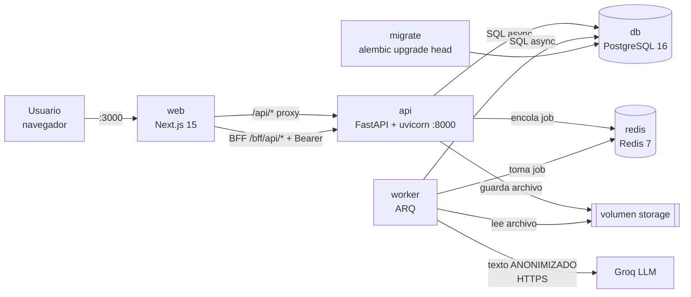
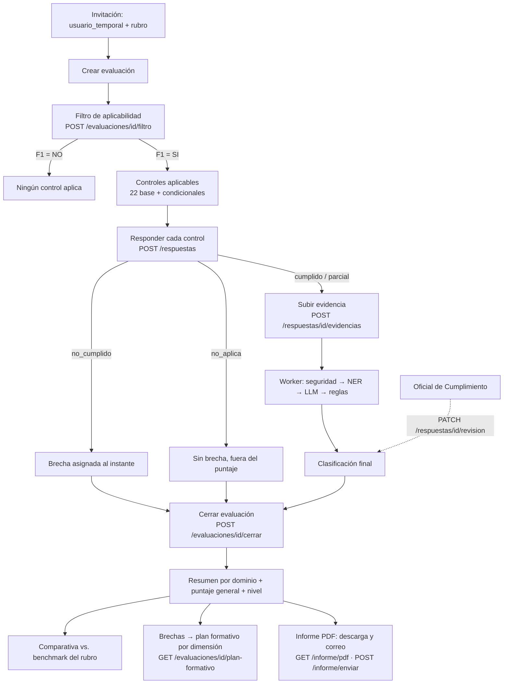
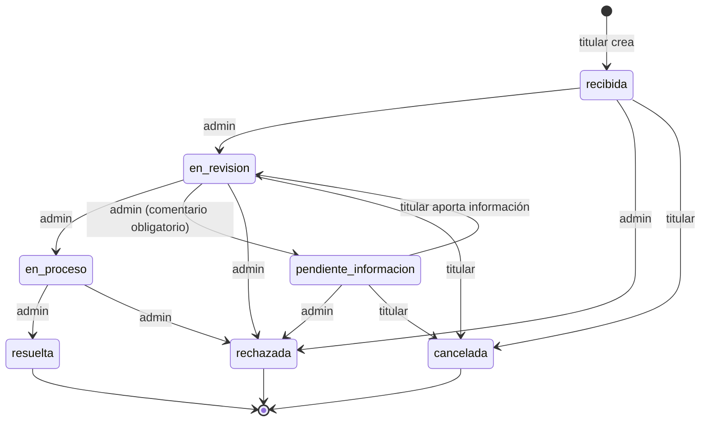
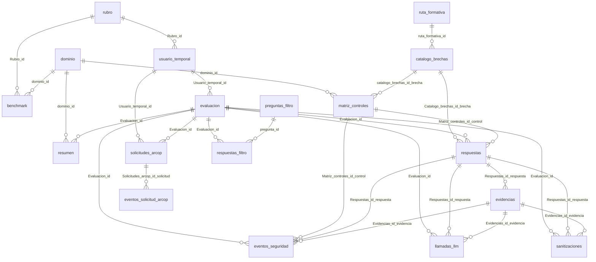

# ComplianceIA — Plataforma de Evaluación de Gobernanza de IA

> Proyecto Capstone para **Therion Labs**. Autodiagnóstico de madurez en gobernanza de Inteligencia Artificial para empresas, con validación de evidencias asistida por LLM, reportes de madurez, rutas formativas y panel de estadísticas comparativas por rubro.

| | |
|---|---|
| **Cliente** | Therion Labs (Seguridad y Gobernanza de IA, miembro de la Comisión de Seguridad IA – CCHIA) |
| **Marcos normativos** | Ley N.º 21.719 (Chile), ISO/IEC 42001, NIST AI RMF 100-1, NIST AI 600-1, OWASP Top 10 for LLM |
| **Metodología** | Scrumban (Por hacer → En curso → Listo, con límite WIP) |
| **Meta de madurez** | TRL 5 — validación de componentes en entorno representativo (local, simulando uso real) |
| **Stack** | FastAPI · SQLAlchemy 2.0 async · PostgreSQL 16 · Redis 7 · ARQ · Groq · spaCy · Next.js 15 + React 19 · Docker Compose |
| **Última actualización** | 22-oct-2026 (HU-20: confidencialidad del diagnóstico · limpieza: un solo `.env`, prototipo y documentos de cambios a `Extras/`) |

---

## Tabla de contenidos

1. [Contexto del proyecto](#1-contexto-del-proyecto)
2. [Estado actual](#2-estado-actual)
3. [Arquitectura](#3-arquitectura)
4. [Estructura del repositorio](#4-estructura-del-repositorio)
5. [Flujos funcionales](#5-flujos-funcionales)
6. [Base de datos](#6-base-de-datos)
7. [Endpoints de la API](#7-endpoints-de-la-api)
8. [Capa de Políticas e IA](#8-capa-de-políticas-e-ia)
9. [Seguridad y privacidad (Ley 21.719)](#9-seguridad-y-privacidad-ley-21719)
10. [Frontend](#10-frontend)
11. [Datos maestros](#11-datos-maestros)
12. [Puesta en marcha](#12-puesta-en-marcha)
13. [Variables de entorno](#13-variables-de-entorno)
14. [Pruebas y calidad](#14-pruebas-y-calidad)
15. [Comandos útiles y solución de problemas](#15-comandos-útiles-y-solución-de-problemas)
16. [Backlog, deuda técnica y riesgos](#16-backlog-deuda-técnica-y-riesgos)
17. [Documentación complementaria](#17-documentación-complementaria)

---

## 1. Contexto del proyecto

### Problema

La IA corporativa se está adoptando sin políticas de seguridad, las auditorías se hacen a mano en hojas de cálculo y la entrada en vigencia de la **Ley 21.719** (protección de datos personales) presiona a las organizaciones a demostrar cumplimiento. Como resume el cliente: *la IA no falla por falta de tecnología, sino por falta de capacidad interna para gobernarla.*

### Solución: tres funciones principales

| Función | Qué entrega |
|---|---|
| **Autodiagnóstico** | Cuestionario con filtro de aplicabilidad (7 preguntas) y hasta 40 controles; las evidencias se validan con un LLM; produce un reporte de madurez y de brechas. |
| **Rutas formativas** | Formación en 3 niveles (Inicial, Intermedio, Avanzado) × 4 dominios, asignada según las brechas detectadas. |
| **Panel de estadísticas** | Benchmark por rubro y dominio (promedio, mediana, máx., mín.) sin exponer datos de ninguna organización. |

### Equipo

| Integrante | Rol |
|---|---|
| Jerson Reyes | Product Owner |
| Jason Sánchez | Scrum Master |
| Ángel Muñoz | Developer Lead |
| Rodrigo Álvarez | Docente guía |

### Épicas y sprints

**Épicas:** (1) Motor de Autodiagnóstico y Motor de Reglas · (2) Procesamiento Inteligente y Privacidad de Datos con IA · (3) Rutas formativas e Interfaz Dashboard.

| Sprint | Objetivo |
|---|---|
| Sprint 1 | Desarrollo e implementación del backend y reglas de cálculo |
| Sprint 2 | Desplegar motor NER, gestión de derechos ARCOP y cifrado |
| Sprint 3 | Implementar IA, controles, detección de brechas y benchmarking |
| Sprint 4 | Despliegue del frontend, automatización del pipeline y staging para pruebas |

---

## 2. Estado actual

| Área | Estado | Detalle |
|---|---|---|
| Backend FastAPI (Clean Architecture) | ✅ Hecho | 13 routers, 51 endpoints |
| Base de datos y migraciones | ✅ Hecho | 19 tablas, 18 migraciones Alembic, seeds de catálogos, controles y filtro |
| Filtro de aplicabilidad (F1–F7) | ✅ Hecho | Árbol de decisión aditivo (22 controles base + 18 condicionales) |
| Respuestas y reglas de clasificación | ✅ Hecho | Matriz de 5 estados declarables (HU-02): `requiere_revision` la elige el usuario y la resuelve el LLM; justificación obligatoria en parcial y revisión |
| Validación de evidencias con LLM (worker ARQ + Groq) | ✅ Hecho | Asíncrona; el backend decide, el LLM solo propone |
| Capa de Políticas e IA (gateway, prompts versionados, métricas) | ✅ Hecho | `GET /api/ia/metricas`, revisión humana. HU-15: agente de **LangGraph** que orquesta las skills `validar_evidencia` y `tutor` (el gateway sigue siendo la única salida al LLM) |
| Gobernanza del Agente IA (HU-18) | ✅ Hecho | Scope locking en el system prompt (`tutor/1.2.0`) con canario por llamada, filtro de entrada por categoría de ataque (inyección, jailbreak, fuga del prompt, delimitadores, codificado, uso indebido, varios turnos), validación de la salida, advertencia tras 3 bloqueos y bitácora encadenada con HMAC verificable. Ver [5.13](#513-gobernanza-del-agente-ia-hu-18) y `Extras/Cambios/backend/CAMBIOS_HU18.md` |
| Agente IA Tutor (HU-15) | ✅ Hecho | Chat en el panel de formación para el usuario definitivo con contrato vigente: explicaciones y planes de acción por nivel (Inicial/Intermedio/Avanzado) sobre las brechas no conformes de la evaluación más reciente de **su** empresa; mensajes anonimizados, cuota diaria por empresa (60), borrado a los 30 días sin actividad y con la supresión ARCOP. Ver [5.12](#512-agente-ia-tutor-hu-15) y `Extras/Cambios/backend/CAMBIOS_HU15.md` |
| Motor NER de anonimización + cifrado del mapa de entidades | ✅ Hecho | spaCy `es_core_news_md` + reglas; fail-closed. **v1.1.0 optimizada (T-04): 25 ms por página (p95), precisión 0,988, cobertura de PII 100 %** |
| PII → tokens antes de persistir (HU-06) | ✅ Hecho | Justificaciones y nombres de archivo anonimizados al guardar; evidencias cifradas en disco y reemplazadas por su texto anonimizado; mapa de entidades irreversible; textos ARCOP cifrados (excepción); prueba de regresión sobre BD, disco y logs. Ver `Extras/Cambios/backend/CAMBIOS_HU06.md` |
| Minimización de datos y plazos de conservación (T-06) | ✅ Hecho | Inventario de las 171 columnas (26 con datos personales, en 9 tablas) con finalidad, base de licitud y plazo; auditoría de solo lectura sobre la BD real (DER, matriz, escaneo de contenido); anonimización por plazo vencido (cron diario, plazos pendientes del PO). Ver `Extras/Cambios/backend/CAMBIOS_T06.md` |
| Capa anti prompt-injection | ✅ Hecho | Bloqueo preventivo y bandeja de eventos |
| Reportes: cierre, resumen por dominio, comparativa, benchmark | ✅ Hecho | Benchmark recalculado **al completar cada evaluación** y por cron diario; la comparativa trae siempre la **meta de cumplimiento** (75) y el promedio del rubro solo con ≥ 3 evaluaciones (ver [5.7](#57-benchmark-sectorial-y-meta-de-cumplimiento)) |
| Planes de estudio recomendados (HU-12) | ✅ Hecho | Mapeo automático brecha → ruta del catálogo formativo, nivel Inicial/Intermedio/Avanzado por dimensión con objetivos, panel `/panel/capacitacion` organizado por dimensión normativa y exportación CSV. Ver [5.10](#510-plan-formativo-hu-12) y `Extras/Cambios/CAMBIOS_HU12.md` |
| Informe PDF y envío por correo | ✅ Hecho | El servidor genera el PDF (resultado, comparativa, brechas priorizadas y plan formativo): se **descarga directo** desde el panel (ya no abre la impresión) y se **envía por correo** como adjunto (SMTP, p. ej. Gmail). Ver [5.11](#511-informe-pdf-y-envío-por-correo) y la guía `frontend-next/docs/Guia_envio_informe_por_correo.pdf` |
| Derechos ARCOP (Ley 21.719) + autenticación por roles | ✅ Hecho | Titular y administrador; anonimización al aprobar una supresión |
| Dockerización completa | ✅ Hecho | `docker compose up -d --build` levanta los 6 servicios; un solo `Proyecto/.env` para todo, con los puertos del host configurables (ver 12.1) |
| Suite de pruebas (pytest) | ✅ Hecho | 133 funciones de prueba (212 casos) + prueba en vivo, prueba de latencia y pruebas de rendimiento del NER |
| Panel web (HU-13, HU-11, HU-12) | ✅ Hecho | `frontend-next/` (Next.js 15 + React 19): diagnóstico, dominios, brechas priorizadas por severidad (HU-11) y capacitación (HU-12), con radar y barras interactivos, meta de cumplimiento, descarga del informe PDF y envío por correo; conectado a la API real; responsivo ≥ 1024 px y WCAG 2.1 AA. Ver [sección 10.1](#101-panel-web-hu-13-hu-11-hu-12) |
| Resto del frontend (backoffice de matriz y árbol) | 🟡 Demo estática | Cuestionario (HU-01/02), landing (HU-19), informe y formación ya están en `frontend-next/`; el backoffice solo existía en el prototipo HTML (API **simulada** en `localStorage`), archivado en `Extras/frontend-prototipo/` |
| Alta de invitaciones (usuario temporal) y evaluaciones por API | 🔴 Pendiente | Hoy se crean por SQL |
| Autenticación en todos los endpoints (HU-20) | ✅ Hecho | Evaluaciones, respuestas, evidencias y reportes exigen el token del encuestado/referente dueño o de un admin (404 en lo ajeno); métricas de IA, eventos de seguridad y revisión humana solo admin; catálogos, controles y landing públicos. Ver `Extras/Cambios/backend/CAMBIOS_HU20.md` |
| CRUD de administración de matriz/árbol (backend) | 🔴 Pendiente | Existe solo en la demo del frontend |
| Pipeline CI/CD y staging | 🔴 Pendiente | Sprint 4 |

El detalle priorizado de lo pendiente está en la [sección 16](#16-backlog-deuda-técnica-y-riesgos).

---

## 3. Arquitectura

### Vista de componentes



| Servicio Docker | Imagen | Puerto (solo `127.0.0.1`) | Función |
|---|---|---|---|
| `web` | `complianceai-web` | 3000 | Frontend en Next.js (`frontend-next/`): landing, cuestionario y panel; reenvía `/api` al servicio `api` (mismo origen, sin CORS) |
| `api` | `complianceai-backend` | 8000 | FastAPI (`/docs` para Swagger) |
| `worker` | `complianceai-backend` | — | ARQ: valida evidencias y recalcula el benchmark (cron 02:00 UTC) |
| `migrate` | `complianceai-backend` | — | `alembic upgrade head` y termina |
| `db` | `postgres:16` | 5433 | Base de datos `complaince_db` |
| `redis` | `redis:7-alpine` | 6379 | Cola de trabajos de ARQ |

Orden de arranque: `db` sano → `migrate` termina bien → `api` y `worker` → `web`. Toda la configuración vive en un solo archivo, `Proyecto/.env` (plantilla `Proyecto/.env.example`), y ahí mismo se cambia cada puerto del host (`WEB_PORT`, `API_PORT`, `DB_PORT`, `REDIS_PORT`). El prototipo HTML que corría en `:8088` quedó archivado en `Extras/frontend-prototipo/`. La API y el worker comparten el volumen `storage` (evidencias). La imagen del backend es única (multi-stage, Python 3.13-slim, usuario sin privilegios) e incluye spaCy con el modelo `es_core_news_md`.

### Clean Architecture

```
┌────────────────────────────────────────────────────────────────┐
│ api/            Rutas FastAPI, validación de entrada, errores  │
├────────────────────────────────────────────────────────────────┤
│ application/    Casos de uso, filtros, schemas, capa de IA     │
├────────────────────────────────────────────────────────────────┤
│ domain/         Modelos (entidades) y puertos (interfaces ABC) │
├────────────────────────────────────────────────────────────────┤
│ infrastructure/ Adaptadores: repositorios SQLAlchemy, Groq,    │
│                 storage local, NER, cifrado, prompt guard      │
├────────────────────────────────────────────────────────────────┤
│ core/           Configuración, BD, autenticación               │
│ worker/         Tareas ARQ                                     │
└────────────────────────────────────────────────────────────────┘
```

**Regla de dependencia:** las capas externas dependen de las internas, nunca al revés. Cambiar el LLM (Groq → otro proveedor) o el storage (local → S3) es reemplazar un adaptador sin tocar la lógica de negocio. Puertos definidos: `LLMProviderPort`, `SanitizerPort`, `RegistroIAPort`, `PromptGuardPort`, `EvidenceValidatorPort`, `FileStoragePort`.

### Principios de diseño

1. **El LLM nunca accede a la BD.** Solo recibe texto (prompt) y devuelve JSON validado con Pydantic. El backend es el único que lee y escribe.
2. **El backend decide, el LLM propone.** Umbral de confianza, degradación y asignación de brechas son reglas de negocio del backend.
3. **Ningún dato personal sale en claro.** Todo texto no confiable pasa por el motor NER antes de llegar al proveedor; si la sanitización falla, se aborta (*fail-closed*).
4. **Nada se guarda con PII en claro (HU-06).** Justificaciones y nombres de archivo se anonimizan antes de escribirse; los archivos de evidencia viven cifrados hasta que el worker los reemplaza por su texto anonimizado; los textos ARCOP se cifran (excepción documentada).
5. **Todo queda auditado.** Cada llamada al LLM se registra en `llamadas_llm`; cada mapa de entidades (tipos, huellas HMAC y conteos, sin valores: HU-06) en `sanitizaciones`; cada intento de inyección en `eventos_seguridad`; cada cambio ARCOP en `eventos_solicitud_arcop`.

---

## 4. Estructura del repositorio

```
Capstone/
├── Documentos/                     # Entregables académicos por fase e integrante
│   ├── Fase 1/                     # Guía, formativa, bitácora CPCITT, presentación, autoevaluaciones
│   └── Fase 2/                     # Diarios de reflexión
├── Extras/                         # Evidencia y documentación de apoyo (no se ejecuta). Ver Extras/README.md
│   ├── Cambios/                    # Documentos CAMBIOS_*.md de cada HU/tarea (backend/, frontend/, HU-12)
│   ├── Evidencias/                 # Reportes de latencia, capturas e informes de ejemplo
│   ├── frontend-prototipo/         # Prototipo HTML/JS original (con su nginx.conf), reemplazado por frontend-next
│   └── Guia_ComplianceAI_PromptInjection.docx.pdf
└── Proyecto/
    ├── README.md                   # ← este documento
    ├── .env.example                # Plantilla del ÚNICO .env (compose, backend y frontend)
    ├── docker-compose.yml          # Sistema completo (6 servicios)
    ├── frontend-next/              # Panel web Next.js (HU-13, ver sección 10.1)
    │   ├── app/                    # /panel, /panel/dominios, /panel/brechas, /panel/capacitacion (HU-12),
    │   │                           # landing y cuestionario (/, /comenzar, /encuesta, /retomar), bff/ + globals.css
    │   ├── components/             # charts/, shell/, vistas/, ui/, brechas/ (HU-11), cuestionario/,
    │   │                           # informe/ (Descargar PDF + diálogo de correo)
    │   ├── hooks/                  # usePanel, usePlanFormativo (HU-12), useCuestionario, …
    │   ├── lib/                    # Tipos de la API, adaptadores, cliente HTTP, severidad, planFormativo, datos demo
    │   ├── tests/                  # vitest (adaptadores, HU-11, cuestionario, encuesta, HU-12)
    │   ├── docs/                   # ACCESIBILIDAD.md
    │   └── Dockerfile              # Build standalone (node 22)
    └── backend/
        ├── Dockerfile              # Imagen única para migrate, api y worker
        ├── requirements.txt
        ├── alembic.ini
        ├── migrations/versions/    # 18 migraciones Alembic
        ├── scripts/benchmark_ner.py  # Benchmark y profiling del motor NER (T-04)
        ├── scripts/auditoria_minimizacion.py  # T-06: DER, matriz y escaneo de la BD (solo lectura)
        ├── scripts/retencion_datos.py         # T-06: plazos de conservación (simulación / --aplicar)
        ├── scripts/sql/t06_rol_auditor.sql    # T-06: rol de solo lectura para auditar
        ├── tests/                  # Suite pytest (ver sección 14); data/evidencias_ejemplo/ para pruebas manuales
        └── app/
            ├── main.py             # App FastAPI, routers y pool ARQ
            ├── core/
            │   ├── config.py       # Settings (pydantic-settings) + validaciones de producción
            │   ├── database.py     # Engine async, sesión, Base
            │   ├── autenticacion.py# Tokens HMAC, roles, hash de contraseñas, dependencias
            │   └── crear_admin.py  # CLI para crear/desactivar administradores
            ├── api/routes/         # arcop, auth, catalogos, controles, encuesta_publica, evaluaciones,
            │                       # evidencias, filtro, informes (HU-12), metricas_ia, reportes,
            │                       # respuestas, seguridad
            ├── application/
            │   ├── ai/             # gateway.py, politicas.py, metricas.py, evidence_validator.py,
            │   │                   # prompts/ (base.py, validar_evidencia.py)
            │   ├── filters/control_tree.py   # Árbol de aplicabilidad F1–F7
            │   ├── informes/       # HU-12: analisis.py (severidad, brechas, plan formativo; lógica pura),
            │   │                   # carga.py, pdf_informe.py (reportlab), correo.py (SMTP / .eml)
            │   ├── schemas/        # api_schemas, arcop_schemas, evidence_validation
            │   └── use_cases/      # create_respuesta, upload_evidence, process_evidence,
            │                       # responder_filtro, generate_resumen, update_benchmark,
            │                       # obtener_metricas_ia, registrar_evento_seguridad,
            │                       # gestionar_solicitud_arcop, iniciar_sesion
            ├── domain/
            │   ├── models/         # 19 entidades SQLAlchemy (ver sección 6)
            │   └── ports/          # Interfaces ABC
            ├── infrastructure/
            │   ├── llm/            # groq_provider.py, factory.py
            │   ├── repositories/   # 10 repositorios
            │   ├── security/       # ner_sanitizer.py, cifrado.py, prompt_guard.py, seguridad.py
            │   └── storage/        # local_storage.py, archivo_cifrado_storage.py (HU-06)
            └── worker/tasks.py     # process_evidence_task + cron update_benchmark_task
```

---

## 5. Flujos funcionales

### 5.1 Recorrido completo de un diagnóstico



> Los pasos A y B aún no tienen endpoint: se crean por SQL (ver [12.3](#123-preparar-datos-de-prueba)).

### 5.2 Filtro de aplicabilidad (preguntas de compuerta)

Las 7 preguntas se responden SI/NO y deben venir **todas** en un mismo envío (se puede rehacer: las anteriores se reemplazan). F1 es la compuerta raíz; F2–F7 suman controles al conjunto base.

| Código | Pregunta | Controles que activa (si SI) |
|---|---|---|
| F1 | ¿La organización utiliza, desarrolla o integra algún sistema, modelo o herramienta de IA? | **Base (22):** DAT-001, 003, 004, 005, 006, 010 · GOB-001, 002, 003, 004, 005, 007, 009, 010 · RIE-001, 003, 004, 008, 010 · SEG-006, 007, 009. Si es NO no aplica ninguno |
| F2 | ¿Procesa datos sensibles (salud, biométricos o perfilamiento de personas/menores)? | DAT-002, DAT-009 |
| F3 | ¿Usa servicios, APIs, SaaS o plataformas de IA de terceros o en nube internacional? | DAT-007, DAT-008, GOB-008, SEG-008 |
| F4 | ¿Usa LLM, IA generativa o arquitecturas RAG / bases vectoriales? | RIE-002, SEG-001, SEG-002, SEG-005 |
| F5 | ¿La IA genera código/SQL/HTML o ejecuta acciones/agentes conectados a otros sistemas? | RIE-009, SEG-003, SEG-004 |
| F6 | ¿La IA toma decisiones que afectan derechos, personas, crédito o contrataciones? | RIE-005, RIE-006, SEG-010 |
| F7 | ¿La empresa desarrolla, entrena o adapta internamente modelos o agentes de IA? | RIE-007, GOB-006 |

Lógica en `app/application/filters/control_tree.py`.

### 5.3 Respuesta a un control

Matriz de **5 estados** que el usuario elige (HU-02):

| Clasificación declarada | Valor | ¿Justificación obligatoria? | ¿Lleva evidencia? | ¿Pasa por el LLM? | Brecha |
|---|---|---|---|---|---|
| Cumplido | `cumplido` | No | Sí | Sí | Solo si el LLM la degrada a `no_cumplido` |
| Parcialmente cumplido | `parcialmente_cumplido` | **Sí** (mín. 20 caracteres) | Sí | Sí | Solo si el LLM la degrada a `no_cumplido` |
| No cumplido | `no_cumplido` | No | No | No | **Se asigna al crear la respuesta** |
| No aplica | `no_aplica` | No | No (subirla da 400) | No | No |
| Requiere revisión | `requiere_revision` | **Sí** (mín. 20 caracteres) | **Sí, obligatoria para completar** | Sí: **el LLM decide** `cumplido`, `parcialmente_cumplido` o `no_cumplido` | Si el LLM decide `no_cumplido` |

- **Requiere revisión** (decisión del PO, 16-oct): el usuario la elige cuando no sabe cómo clasificar el control. Adjunta evidencia y el LLM la clasifica (prompt `validar_evidencia/1.2.0`). Si el LLM no alcanza el umbral de confianza, el control queda en `requiere_revision` para la **revisión humana** (`PATCH /revision`). Mientras no se resuelva puntúa 0. La capa de seguridad también puede asignar este estado (`fuente = seguridad`).
- **Justificación obligatoria** en `parcialmente_cumplido` y `requiere_revision`: al menos `JUSTIFICACION_MIN_CARACTERES` (20) caracteres, sin contar espacios repetidos ni de los extremos, y con letras (no solo signos o números). Si no, `422 JUSTIFICACION_OBLIGATORIA` en `POST` y `PUT`.

Al crear la respuesta, la **justificación** pasa por el detector de prompt injection: si es sospechosa se rechaza con `422 PROMPT_INJECTION` y se registra un evento de seguridad.

**Reglas del cuestionario (HU-01):**

- **Una respuesta por control y evaluación** (restricción única `uq_respuesta_evaluacion_control`). `POST /api/respuestas/` es un *upsert*: la primera vez crea (201) y luego actualiza la misma fila (200, mismo `id_respuesta`). Si se reenvía exactamente la misma declaración no se modifica nada (el guardado automático no borra la validación del LLM); si cambia, la declaración nueva pasa a ser el estado vigente (`fuente = usuario`) y se descarta la validación anterior (LLM o revisión). Las evidencias ya subidas se conservan.
- Solo se aceptan respuestas a evaluaciones **existentes** (404 `EVALUACION_NO_ENCONTRADA`), **abiertas** (409 `EVALUACION_CERRADA` si `estado_progreso` es `completada` o `cerrada`), **con el filtro completado** (409 `FILTRO_PENDIENTE`) y a controles **aplicables** según F1–F7 (422 `CONTROL_NO_APLICABLE`; 404 `CONTROL_NO_ENCONTRADO`). Una evaluación cerrada tampoco permite rehacer el filtro ni subir evidencias. Se cierra con `POST /api/evaluaciones/{id}/completar`.
- `GET /api/evaluaciones/{id}/progreso` devuelve respondidos / aplicables, el avance por dimensión, el siguiente control pendiente y el estado declarado de cada control ya respondido, para **reanudar** el cuestionario. Si se rehace el filtro, las respuestas de controles que dejan de aplicar no cuentan (`respuestas_fuera_de_alcance`).

### 5.4 Validación asíncrona de evidencias

```mermaid
sequenceDiagram
    autonumber
    participant C as Cliente
    participant API as API FastAPI
    participant FS as Storage
    participant Q as Redis (ARQ)
    participant W as Worker
    participant G as Capa IA (AIGateway)
    participant L as Groq
    participant DB as PostgreSQL

    C->>API: POST /api/respuestas/{id}/evidencias (archivo)
    API->>DB: valida respuesta (solo cumplido/parcial)
    API->>FS: guarda archivo (uuid_nombre) + hash SHA-256
    API->>DB: evidencia estado=pending
    API->>Q: enqueue process_evidence_task
    API-->>C: 202 Accepted
    Q->>W: job
    W->>DB: evidencia → processing; carga respuesta, control y brecha
    W->>W: prompt guard sobre justificación y evidencia
    alt inyección detectada (modo bloquear)
        W->>DB: evidencia rejected, respuesta requiere_revision, evento_seguridad
    else texto limpio
        W->>G: ejecutar(VALIDAR_EVIDENCIA, textos, datos)
        G->>G: NER anonimiza (falla ⇒ aborta)
        G->>DB: mapa de entidades CIFRADO (sanitizaciones)
        G->>L: prompt versionado SOLO con texto anonimizado
        L-->>G: JSON (clasificación, confianza, justificación…)
        G->>DB: métrica (llamadas_llm)
        G-->>W: resultado validado
        W->>W: reglas de decisión del backend
        W->>DB: evidencia + clasificación final de la respuesta
    end
```

**Reglas de decisión** (`ProcessEvidenceUseCase._apply_classification_decision`), con `UMBRAL_CONFIANZA = 0.8` por defecto:

| # | Condición | Resultado en la respuesta | Evidencia | Fuente |
|---|---|---|---|---|
| 0 | Evidencia marcada como sospechosa y confianza < umbral | `requiere_revision` | `rejected` | `seguridad` |
| 1 | Confianza < umbral | Se mantiene lo declarado por el usuario | `rejected` | `usuario` |
| 2 | Confianza ≥ umbral | Clasificación propuesta por el LLM | `validated` | `llm` |
| 3 | Clasificación final = `no_cumplido` | Se asigna la brecha del control; con cualquier otro estado final se **quita** (`Respuesta.sincronizar_brecha`) | — | — |
| — | Error de la capa de IA (NER, timeout, rate limit, salida inválida…) | Sin cambios | `error` con mensaje sin PII | — |

Estados de una evidencia: `pending` → `processing` → `validated` | `rejected` | `error`. El worker reintenta hasta 3 veces y cada job tiene 300 s de límite.

### 5.5 Revisión humana

`PATCH /api/respuestas/{id}/revision` permite al Oficial de Cumplimiento fijar la clasificación final (`fuente_clasificacion = revision`). Si queda en `no_cumplido` se asigna la brecha. Esa revisión es la **verdad de referencia** para medir la precisión del LLM en `/api/ia/metricas`.

### 5.6 Cierre, puntaje y nivel de madurez

`POST /api/evaluaciones/{id}/cerrar` (re)genera la tabla `resumen`:

1. Considera solo controles **aplicables** según el filtro y con respuesta registrada.
2. Excluye `no_aplica`.
3. Puntúa: `cumplido` = 1 · `parcialmente_cumplido` = 0,5 · `no_cumplido` = 0 · `requiere_revision` = 0 (cuenta en el denominador, para que inyectar texto nunca suba el puntaje).
4. Puntaje del dominio = promedio × 100. Puntaje general = promedio ponderado por cantidad de controles.

| Puntaje | Nivel de madurez |
|---|---|
| 0 – 25 | `inicial` |
| > 25 – 50 | `en_desarrollo` |
| > 50 – 75 | `gestionado` |
| > 75 – 100 | `optimizado` |

Si todos los controles quedan fuera (F1 = NO o 100 % `no_aplica`), no se genera resumen y `GET /resumen` responde 404.

### 5.7 Benchmark sectorial y meta de cumplimiento

`UpdateBenchmarkUseCase` borra y recalcula `benchmark` agrupando los resúmenes por **rubro × dominio** (promedio, mediana, máximo, mínimo, cantidad) de las evaluaciones con `estado_progreso = 'completada'` (sin las de prueba). Se ejecuta **al completar cada evaluación** (`BENCHMARK_AL_COMPLETAR=true`; si falla, `/completar` responde igual) y en el cron diario de ARQ (02:00 UTC), que lo repara.

> Antes solo corría el cron: quien terminaba el cuestionario no veía la comparativa hasta el día siguiente. Ese era el motivo de que "no saliera la comparativa con la industria".

`GET /api/evaluaciones/{id}/comparativa` devuelve por dominio:

- la **meta de cumplimiento** (`META_CUMPLIMIENTO_PUNTAJE`, 75 = techo de *gestionado*): lo que debería alcanzar cada dimensión, la diferencia y si la cumple. Está siempre, aunque no haya benchmark ni rubro;
- el **promedio del rubro**, solo si hay `COMPARATIVA_MIN_MUESTRAS` evaluaciones completadas o más (3 por defecto; con 1 sería la propia empresa). Si no, `promedio_industria = null` y `muestras` indica cuántas hay; el panel lo explica en texto.

### 5.8 Solicitudes de derechos ARCOP (Ley 21.719)

Historia de usuario: *como Titular de Datos Personales quiero registrar solicitudes formales de Acceso, Rectificación, Supresión, Oposición, Portabilidad o Bloqueo.* Tipos: `acceso`, `rectificacion`, `supresion`, `oposicion`, `portabilidad`, `bloqueo`.



- Cada cambio queda en `eventos_solicitud_arcop` en la misma transacción.
- Una **supresión resuelta** anonimiza de forma irreversible los datos del titular (email, justificaciones, evidencias y sus archivos, mapas de entidades, extractos de seguridad, descripciones ARCOP) y conserva clasificaciones y puntajes sin vínculo personal. El titular pierde el acceso al instante.
- Cada solicitud tiene un **código de seguimiento único** (`ARC-XXXX-XXXX`); el estado se consulta sin login en `GET /api/arcop/seguimiento/{codigo}`, sin datos personales.
- **Plazos legales por defecto (Ley 21.719):** respuesta en 30 días corridos, prórroga única de 30 días con motivo, bloqueo temporal en 2 días hábiles (configurables con `ARCOP_PLAZO_*`). Se informa `plazo_vencido` y el filtro `?vencidas=true`.
- El titular puede ser un **invitado** o un **encuestado anónimo** de la encuesta pública (entra con la clave de su evaluación).
- Detalle completo, tabla de anonimización y decisiones pendientes: [`Extras/Cambios/backend/CAMBIOS_ARCOP.md`](../Extras/Cambios/backend/CAMBIOS_ARCOP.md).

### 5.9 Autenticación y roles

| Rol | Quién | Cómo obtiene el token |
|---|---|---|
| `referente` | Usuario temporal (titular de sus datos) | `POST /api/auth/titular` con `{usuario_temporal_id, email}`; requiere invitación vigente y no anonimizada |
| `encuestado` | Encuestado anónimo de la encuesta pública (titular de sus datos) | `POST /api/auth/encuestado` con `{evaluacion_id, clave}`; la clave se genera por evaluación (`POST /api/auth/encuestado/clave`, admin; luego HU-19) |
| `admin_therion` | Administrador de Therion Labs (tabla `usuarios_admin`) | `POST /api/auth/login` con `{email, password}` |
| `cliente` | Usuario definitivo de una empresa cliente (HU-27; uno por empresa, tabla `usuario_definitivo`). Ve las evaluaciones migradas a su empresa | `POST /api/auth/cliente` con `{email, password}`, tras definir su contraseña con el enlace de activación |

- Token bearer firmado con HMAC-SHA256 (`AUTH_SECRET`), vigencia `AUTH_TOKEN_TTL_MIN` (480 min por defecto). Respuesta: `{access_token, token_type, rol, usuario_id, expira_en_min}`.
- Contraseñas con PBKDF2-SHA256 (600 000 iteraciones); verificación en tiempo constante y hash señuelo para no revelar emails existentes.
- En cada petición se comprueba en BD que el admin siga activo o que el titular no esté anonimizado (401 `USUARIO_DESHABILITADO`).
- HU-28: los logins con contraseña (admin y cliente) abren una **sesión revocable** (`sesion_usuario`); el token lleva su `sid` y `POST /api/auth/logout` o restablecer la contraseña la cierran. Los intentos **fallidos** se limitan por cuenta (`LOGIN_MAX_FALLOS_CUENTA`, 5) y por IP (`LOGIN_MAX_FALLOS_IP`, 20) en ventanas de `LOGIN_VENTANA_FALLOS_MIN` (15) minutos → 429 `DEMASIADOS_INTENTOS`; el contador de la cuenta usa la huella del correo escrito, exista o no. Cada intento (exitoso, fallido o bloqueado) queda en la bitácora.
- HU-28: recuperación de contraseña por enlace de un solo uso (`/restablecer#token=…`, vence en `RECUPERACION_TTL_MIN`); la respuesta no revela si el correo existe.
- En el navegador el token nunca es visible: el BFF de Next.js lo guarda en cookies httpOnly (`cai_sesion` del encuestado, `cai_admin` del admin y `cai_cliente` del cliente; `__Host-` en producción).
- Administradores: `docker compose exec api python -m app.core.crear_admin --email admin@therionlabs.cl` (contraseña mínima de 12 caracteres; `--desactivar` corta el acceso).
- Token de prueba solo para desarrollo: `python -m app.core.autenticacion --usuario 1 --rol referente`.

### 5.10 Plan formativo (HU-12)

`GET /api/evaluaciones/{id}/plan-formativo` arma el plan de estudio a partir de las brechas de la evaluación (lógica pura en `application/informes/analisis.py`, la misma que usa el PDF):

1. **Mapeo automático:** cada brecha (no cumplida o parcial) activa la ruta que el catálogo le asigna (`catalogo_brechas.ruta_formativa_id`). Los parciales, que no llevan brecha en la respuesta, se mapean por la brecha de su control. Las brechas sin ruta se informan aparte (cobertura del mapeo).
2. **Nivel por dimensión** según el puntaje del dominio: ≤ 50 **Inicial** · ≤ 75 **Intermedio** · > 75 **Avanzado**, con su objetivo. La ruta de ese nivel entra siempre como "Base del nivel".
3. **Agrupado por dimensión normativa** (el dominio de la ruta, que puede no ser el de la brecha: `ERR-DAT-002` → *Gestión de Riesgos – Intermedio*). Módulos ordenados Inicial → Intermedio → Avanzado y por severidad (Crítica primero).

Cada módulo trae objetivo general, objetivos específicos, contenidos, horas, modalidad, público objetivo y las brechas que cierra.

### 5.11 Informe PDF y envío por correo

- `GET /api/evaluaciones/{id}/informe/pdf` genera el informe con **reportlab**: resultado general, comparativa con meta y rubro, brechas priorizadas (HU-11) y plan formativo (HU-12). Acepta los filtros del listado (`severidad`, `dominio`, `estado`, `q`). El panel lo **descarga directo** (`Content-Disposition: attachment`).
- `POST /api/evaluaciones/{id}/informe/enviar` `{email?, recordar?, filtros…}` envía **ese mismo PDF** como adjunto, para que quede en la bandeja si se pierde el archivo. El PDF siempre lo genera el servidor con datos de la BD (no se aceptan archivos del cliente). El encuestado puede omitir el correo (se usa el registrado) o guardarlo con `recordar`. Límite: 3 envíos por evaluación y 10 por IP al día.
- `CORREO_MODO`: `archivo` (defecto en desarrollo: el `.eml` queda en `STORAGE_DIR/correos`, no sale nada), `smtp` (envío real) o `desactivado`. Configuración en [12.1, paso 4](#121-con-docker-recomendado).

### 5.12 Agente IA Tutor (HU-15)

La capa de IA pasó a ser un **agente de LangGraph** (`application/ai/agente/`). El grafo tiene un nodo `guardia` (prompt injection, antes del LLM y del NER), un router **determinista** que elige la skill según lo que pide el caso de uso, y una skill por tarea: `validar_evidencia` (la evaluación de evidencias de siempre, sin cambios de comportamiento) y `tutor` (con un nodo final que ancla la salida a las brechas del contexto). Cada skill llama al `AIGateway` con su `TareaIA`, así que sanitización, prompt versionado (`tutor/1.2.0` desde HU-18), schema estricto y métricas siguen en un solo lugar. El LLM no tiene herramientas ni toca la BD: el caso de uso `TutorIA` carga el contexto, invoca el agente y persiste.

1. **Contexto aislado:** la empresa sale del token; se usan solo las brechas `no_cumplido` y `parcialmente_cumplido` de la evaluación más reciente con resultados, con datos de catálogo y del control; para las brechas en foco van además la obligación, la evidencia esperada y la fuente normativa real del control, y los antecedentes de la propia empresa (su justificación y su última evidencia, que pasan otra vez por el NER). No van la razón social ni datos de contacto. Se recarga en cada mensaje, así que el tutor ve las mejoras de la remediación (HU-17).
2. **Nivel:** por defecto el de la ruta (la del módulo desde el que se abrió o la de la brecha más prioritaria); el usuario lo cambia con `PATCH`.
3. **Chat síncrono** con la respuesta ya validada; texto anonimizado en `mensaje_tutor`; cuota `TUTOR_MENSAJES_DIA_EMPRESA` (60) y ráfaga por minuto; conversaciones de una evaluación anterior quedan de solo lectura.

### 5.13 Gobernanza del Agente IA (HU-18)

El agente se somete a los mismos controles que el sistema exige a las empresas. El system prompt del tutor fija una función única (explicar brechas, armar planes de remediación y orientar hacia las rutas formativas) y lleva un código de control distinto en cada llamada; si ese código o un trozo largo del prompt aparece en la respuesta, la respuesta se reemplaza antes de guardarse. Antes del LLM, el nodo `guardia` pasa el mensaje por `FiltroAgente` (reglas locales, sin costo): si es un ataque se responde según la categoría sin llamar al modelo, y los antecedentes guardados por la empresa que traen instrucciones se omiten línea por línea sin bloquear al usuario. Después del LLM, `validar_salida` quita código y enlaces externos y limpia las respuestas fuera de alcance.

Toda interacción (respondida, bloqueada o rechazada por cuota, largo o permisos) queda en la bitácora con la huella del mensaje y las entidades que el NER enmascaró, nunca con el texto. Cada fila de la bitácora guarda el HMAC de la anterior, de modo que una modificación, un borrado o una inserción en medio se detectan con `GET /api/admin/bitacora/verificacion`. Con 3 bloqueos de la misma empresa en 10 minutos aparece una advertencia en el chat, sin cortar el servicio. El test-set de ataques está en `backend/tests/data/ataques_tutor.jsonl`; la prueba automática mide el filtro y `scripts/evaluar_ataques_tutor.py` lo corre contra Groq.

---

## 6. Base de datos

PostgreSQL 16, **19 tablas** + `alembic_version`, **27 claves foráneas**. Los nombres de algunas columnas FK están en mayúscula inicial (`"Rubro_id"`, `"Evaluacion_id"`…): en `psql` hay que escribirlas entre comillas dobles.

### 6.1 Tablas por capa

**Catálogos (datos maestros, sembrados por migración)**

| Tabla | Filas | Descripción |
|---|---|---|
| `dominio` | 4 | Dominios temáticos |
| `rubro` | 8 | Sectores económicos |
| `ruta_formativa` | 12 | 4 dominios × 3 niveles. HU-12: dimensión, nivel, objetivo, objetivos específicos, contenidos, horas, modalidad y público objetivo |
| `catalogo_brechas` | 40 | Brechas `ERR-XXX-NNN`: comportamiento detectado, criticidad, acción del sistema y ruta formativa |
| `matriz_controles` | 40 | Controles `DAT/GOB/RIE/SEG-NNN`: marco, artículo, obligación, pregunta, evidencia esperada, criticidad, recomendación, test asociado, dominio y brecha |
| `preguntas_filtro` | 7 | Preguntas de compuerta F1–F7 |

**Operacionales**

| Tabla | Descripción |
|---|---|
| `usuario_temporal` | Invitado por link, con expiración, rubro y `fecha_anonimizacion` |
| `evaluacion` | Sesión de diagnóstico: estado, `filtro_completado`, fechas |
| `respuestas_filtro` | Respuesta SI/NO a cada pregunta de compuerta (única por evaluación y pregunta) |
| `respuestas` | Respuesta a un control (única por evaluación y control): clasificación declarada, justificación, clasificación final, fuente (`usuario`/`llm`/`seguridad`/`revision`), confianza, brecha, revisión humana |
| `evidencias` | Archivo de respaldo: ruta, MIME, hash, estado de validación, resultado del LLM |

**Analíticas**

| Tabla | Descripción |
|---|---|
| `resumen` | Puntaje y nivel por evaluación × dominio |
| `benchmark` | Promedio, mediana, máximo, mínimo y cantidad por rubro × dominio |

**Capa de IA y seguridad (auditoría)**

| Tabla | Descripción |
|---|---|
| `llamadas_llm` | Una fila por ejecución de la capa de IA: tarea, proveedor, modelo, versión de prompt, éxito/tipo de error, tokens, costo, latencia, entidades anonimizadas, clasificación y confianza. **Nunca guarda texto del usuario** |
| `sanitizaciones` | Mapa de entidades por texto: metadatos sin PII (`entidades` con huella HMAC) y conteos. `mapa_cifrado` queda en NULL (HU-06: irreversible; solo se llena con `GUARDAR_MAPA_ENTIDADES_CIFRADO=true`). **Nunca se envía al LLM** |
| `eventos_seguridad` | Intentos de prompt injection: origen (justificación/evidencia), extracto anonimizado, hash, revisado |

**Derechos ARCOP y administración**

| Tabla | Descripción |
|---|---|
| `solicitudes_arcop` | Solicitud del titular: tipo, estado, descripción, plazos, respuesta, fechas |
| `eventos_solicitud_arcop` | Historial: tipo de evento, estado anterior/nuevo, rol e id del actor, comentario |
| `usuarios_admin` | Administradores `admin_therion`: email único, hash de contraseña, activo, último acceso |

### 6.2 Modelo entidad-relación



`usuarios_admin` no tiene relaciones (el actor de un evento ARCOP se guarda como `actor_rol` + `actor_id`).

### 6.3 Migraciones (Alembic)

Cadena lineal; la cabeza actual es **`a9d3e5f7c1b2`**.

| # | Revisión | Contenido |
|---|---|---|
| 1 | `84d29cadfb28` | Esquema inicial: `evaluacion`, `matriz_controles`, `respuestas`, `evidencias` |
| 2 | `20674abc0fc2` | `dominio`, `rubro`, `ruta_formativa`, `usuario_temporal`, `catalogo_brechas`, `benchmark`, `resumen` |
| 3 | `b54cdc747a36` | Amplía `matriz_controles` y `catalogo_brechas` |
| 4 | `2e398c9a9b2e` | **Seed:** dominios, rubros, rutas, 40 brechas y 40 controles |
| 5 | `24ce495af093` | `preguntas_filtro`, `respuestas_filtro`, estado del filtro en `evaluacion` |
| 6 | `2d93373ba237` | **Seed:** preguntas F1–F7 |
| 7 | `7c1e5a9d3f20` | `eventos_seguridad` |
| 8 | `a53fb924d0ac` | Ajustes en `eventos_seguridad` y `resumen` |
| 9 | `c4f2a8e1b7d3` | Capa de IA: `llamadas_llm`, `sanitizaciones`, revisión humana en `respuestas` |
| 10 | `b25cc4eed4b0` | Vacía (sin cambios) |
| 11 | `a168283ff2b8` | Clasificaciones a `VARCHAR(25)` y ajustes de columnas de IA |
| 12 | `e5a1c9d4b2f7` | `solicitudes_arcop`, `eventos_solicitud_arcop` |
| 13 | `f7b2d1a8c3e9` | `usuarios_admin`, plazos ARCOP, `usuario_temporal.fecha_anonimizacion` |
| 14 | `9a4e2c7b1f05` | HU-01: una respuesta por evaluación y control |
| 15 | `b3c8e5d2a7f1` | HU-08: código de seguimiento y plazos del encuestado |
| 16 | `d4a7c2e9b8f3` | HU-02: la brecha sigue al estado vigente (corrige filas) |
| 17 | `e2b7c9d4f8a1` | HU-19: encuesta pública (origen, clave de acceso, aviso legal, evaluaciones de prueba) |
| 18 | `a9d3e5f7c1b2` | HU-12: catálogo formativo (columnas de `ruta_formativa` y contenido de las 12 rutas) |

Alembic toma la URL de `DATABASE_URL_SYNC` (`migrations/env.py`).

### 6.4 Minimización y conservación de datos personales (T-06)

Cada columna del modelo está clasificada en `app/core/catalogo_datos_personales.py` con su categoría, tratamiento (en claro, anonimizado, cifrado, hash, HMAC o no se guarda), finalidad, base de licitud y plazo de conservación. `tests/test_t06_minimizacion.py` falla si una migración agrega una columna sin clasificarla. La auditoría sobre la BD real se corre con un rol de solo lectura y genera el DER, la matriz en CSV y un informe de controles; nunca imprime valores, solo conteos:

```powershell
docker compose cp backend/scripts/sql/t06_rol_auditor.sql db:/tmp/t06_rol_auditor.sql
docker compose exec db psql -U postgres -d complaince_db -v "clave='UNA-CLAVE'" -f /tmp/t06_rol_auditor.sql
docker compose exec worker python scripts/auditoria_minimizacion.py --url "postgresql+psycopg2://auditor_t06:UNA-CLAVE@db:5432/complaince_db" --salida /tmp/t06
docker compose cp worker:/tmp/t06 ./auditoria_t06
```

Los plazos `RETENCION_*` (vacíos por defecto) los aplica el worker cada día a las 03:00 UTC con las mismas reglas de una supresión ARCOP: se borran correos, textos, archivos y huellas, y se conservan los puntajes. Detalle en [`Extras/Cambios/backend/CAMBIOS_T06.md`](../Extras/Cambios/backend/CAMBIOS_T06.md).

---

## 7. Endpoints de la API

Base: `http://localhost:8000` (o a través del proxy del frontend en `http://localhost:3000`). Documentación interactiva en `/docs`. Columna **Auth**: 🔓 público · 🔑 cualquier token válido · 👤 titular (`referente` o `encuestado`) · 📋 dueño de la evaluación (su `encuestado` o su `referente`) o `admin_therion` · 🛡️ `admin_therion` · 🏢 `cliente` (usuario definitivo, HU-28).

**HU-20 (confidencialidad):** las rutas 📋 responden 401 sin token y **404** con el token de otra organización (no 403, para no confirmar ids correlativos). Las rutas 🛡️ responden 401 sin token y 403 con otro rol. `EXIGIR_TOKEN_EVALUACIONES=false` (solo desarrollo, prohibido en production) vuelve a abrir sin token las evaluaciones por invitación. Matriz completa por endpoint: `backend/tests/test_hu20_autorizacion.py`; detalle en `Extras/Cambios/backend/CAMBIOS_HU20.md`.

### Sistema

| Método | Ruta | Auth | Descripción |
|---|---|---|---|
| GET | `/health` | 🔓 | Health check (`{"status":"ok"}`) |
| GET | `/docs` | 🔓 | Swagger UI (botón *Authorize* para el token) |

### Autenticación — `/api/auth`

| Método | Ruta | Auth | Body / Respuesta |
|---|---|---|---|
| POST | `/api/auth/login` | 🔓 | `{email, password}` → token de admin |
| POST | `/api/auth/titular` | 🔓 | `{usuario_temporal_id, email}` → token de referente |
| POST | `/api/auth/encuestado` | 🔓 | `{evaluacion_id, clave}` → token de encuestado |
| POST | `/api/auth/encuestado/clave` | 🛡️ | `{evaluacion_id}` → 201 `{clave}` (se muestra una vez; invalida la anterior) |
| GET | `/api/auth/me` | 🔑 | `{usuario_id, rol}` |
| POST | `/api/auth/cliente` | 🔓 | HU-27: `{email, password}` → token del rol `cliente`. HU-30: entra también sin contrato vigente; la respuesta trae `contrato` con su situación |
| POST | `/api/auth/activacion/verificar` | 🔓 | HU-27: `{token}` → ¿el enlace sigue válido? (no lo consume) |
| POST | `/api/auth/activacion` | 🔓 | HU-27: `{token, password}` → define la contraseña; el enlace queda usado (400 `ENLACE_INVALIDO`, 410 `ENLACE_VENCIDO`, 422 `CONTRASENA_DEBIL`) |
| POST | `/api/auth/logout` | 🔑 | HU-28: 204; cierra la sesión del token (admin o cliente): desde ese momento el token responde 401 |
| POST | `/api/auth/recuperacion` | 🔓 | HU-28: `{tipo: cliente\|admin, email}` → SIEMPRE 202 con el mismo mensaje; si la cuenta está activa, envía el enlace (en segundo plano) |
| POST | `/api/auth/recuperacion/verificar` | 🔓 | HU-28: `{token}` → `{tipo, email (enmascarado), password_min}` sin consumir el enlace |
| POST | `/api/auth/recuperacion/restablecer` | 🔓 | HU-28: `{token, password}` → contraseña nueva; enlace usado, todas las sesiones de la cuenta cerradas y aviso por correo (400, 410, 422 como la activación) |

### Catálogos y controles

| Método | Ruta | Auth | Descripción |
|---|---|---|---|
| GET | `/api/dominios` | 🔓 | 4 dominios |
| GET | `/api/rubros` | 🔓 | 8 rubros |
| GET | `/api/rutas-formativas` | 🔓 | 12 rutas |
| GET | `/api/brechas` | 🔓 | 40 brechas con su ruta anidada (corregido: antes `ruta_formativa` venía siempre `null`) |
| GET | `/api/controles?dominio_id=&criticidad=` | 🔓 | 40 controles con dominio y brecha anidados (filtros opcionales; `criticidad` = `Alta`/`Media`/`Baja`) |
| GET | `/api/controles/{id}` | 🔓 | Detalle de un control |

### Evaluaciones, filtro y reportes — `/api/evaluaciones`

| Método | Ruta | Auth | Descripción |
|---|---|---|---|
| GET | `/api/evaluaciones?page=&size=&estado_progreso=` | 🔑 | Lista paginada: el admin ve todas; el encuestado solo la suya y el referente solo las de su invitación |
| GET | `/api/evaluaciones/{id}` | 📋 | Detalle |
| GET | `/api/evaluaciones/{id}/respuestas?page=&size=&estado_final=&fuente=` | 📋 | Respuestas paginadas (filtra por clasificación final o fuente) |
| GET | `/api/evaluaciones/{id}/filtro` | 📋 | Preguntas F1–F7, respuestas guardadas y cantidad de controles aplicables |
| POST | `/api/evaluaciones/{id}/filtro` | 📋 | `{"respuestas":[{"codigo":"F1","respuesta":true}, …]}` (las 7) → controles aplicables |
| GET | `/api/evaluaciones/{id}/controles-aplicables` | 📋 | Controles que aplican (400 si el filtro no está completo). El catálogo sale de una caché en memoria (TTL 5 min) |
| GET | `/api/evaluaciones/{id}/progreso` | 📋 | Progreso del cuestionario para reanudar: `etapa` (`filtro`/`cuestionario`/`completo`/`cerrada`), respondidos / aplicables, `por_dimension`, `siguiente_control`, `pendientes`, `respondidos` |
| POST | `/api/evaluaciones/{id}/cerrar` | 📋 | Genera resumen por dominio, puntaje y nivel general (vista previa: **no** cierra la evaluación, se puede repetir) |
| POST | `/api/evaluaciones/{id}/completar` | 📋 | **Cierre definitivo:** exige filtro completo, todos los controles aplicables respondidos y ninguna evidencia en validación; genera el resumen y marca `estado_progreso = completada` (entra al benchmark). 409 `CUESTIONARIO_INCOMPLETO`, `EVIDENCIAS_EN_PROCESO`, `REVISION_SIN_EVIDENCIA` (control en `requiere_revision` sin evidencia), `FILTRO_PENDIENTE` o `EVALUACION_CERRADA`; 404 si no existe |
| GET | `/api/evaluaciones/{id}/resumen` | 📋 | Resumen guardado (404 si no se ha cerrado) |
| GET | `/api/evaluaciones/{id}/comparativa` | 📋 | Resumen vs. **meta de cumplimiento** (siempre) y benchmark del rubro (solo con ≥ `COMPARATIVA_MIN_MUESTRAS`); trae `meta_puntaje`, `diferencia_vs_meta`, `cumple_meta`, `referencia_suficiente`, `muestras` |
| GET | `/api/evaluaciones/{id}/plan-formativo` | 📋 | HU-12: plan de estudio por dimensión (nivel asignado, objetivo, módulos y brechas que cubren); 404 `SIN_RESULTADOS` si no hay resumen |
| GET | `/api/evaluaciones/{id}/informe/pdf?severidad=&dominio=&estado=&q=` | 📋 | Informe en PDF para descargar (resultado, comparativa, brechas, plan formativo) |
| POST | `/api/evaluaciones/{id}/informe/enviar` | 📋 | `{email?, recordar?, severidad?, …}` → envía el mismo PDF por correo; 422 `EMAIL_REQUERIDO`/`EMAIL_INVALIDO`, 429 `LIMITE_CORREOS`, 502 `CORREO_FALLIDO`, 503 `CORREO_NO_DISPONIBLE` |
| GET | `/api/evaluaciones/benchmark?rubro_id=` | 🔑 | Benchmark por rubro × dominio (datos agregados) |
| PATCH | `/api/evaluaciones/{id}/prueba` | 🛡️ | `{es_prueba}` — excluye/incluye la evaluación del benchmark (HU-19) |

Paginación: `page` ≥ 1, `size` 1–100; respuesta `{items, total, page, size, pages}`.

### Respuestas y evidencias

| Método | Ruta | Auth | Descripción |
|---|---|---|---|
| POST | `/api/respuestas/` | 📋 | `{evaluacion_id, matriz_control_id, estado_clasificacion, justificacion}` (1 de 5 estados) → **upsert**: 201 si crea, 200 si el control ya estaba respondido; cuerpo `{id_respuesta, creada, actualizada}`. 400 estado inválido, 404 evaluación/control inexistente, 409 evaluación cerrada o filtro pendiente, 422 `JUSTIFICACION_OBLIGATORIA`, `CONTROL_NO_APLICABLE` o `PROMPT_INJECTION` |
| PUT | `/api/respuestas/{id}` | 📋 | `{estado_clasificacion, justificacion}` — modifica una respuesta existente (mismas validaciones) |
| GET | `/api/respuestas/{id}` | 📋 | Respuesta con clasificación final, fuente, confianza y evidencias |
| PATCH | `/api/respuestas/{id}/revision` | 🛡️ | `{clasificacion_revisada}` — revisión humana; acepta `cumplido`, `parcialmente_cumplido`, `no_cumplido` o `no_aplica` (no `requiere_revision`). Asigna la brecha si queda `no_cumplido` y la quita en otro caso |
| POST | `/api/respuestas/{id}/evidencias` | 📋 | `multipart/form-data` campo `file` → 202 (procesamiento asíncrono); 400 si la respuesta no es `cumplido`/`parcialmente_cumplido` o el archivo está vacío; 409 `EVALUACION_CERRADA` si la evaluación está completada/cerrada |
| GET | `/api/evidencias/{id}` | 📋 | Estado de validación y resultado del LLM |

### Capa de IA y seguridad

| Método | Ruta | Auth | Descripción |
|---|---|---|---|
| GET | `/api/ia/metricas?desde=&hasta=&tarea=&modelo=` | 🛡️ | `operacion_modelo` (tasa de error global y por tipo, latencia p50/p95, tokens, costo), `precision_modelo` (LLM vs. revisión humana: accuracy, P/R/F1, matriz de confusión) y `sanitizacion` (entidades por tipo, fallos, truncados) |
| GET | `/api/seguridad/eventos?solo_pendientes=&limit=` | 🛡️ | Bandeja de intentos de prompt injection |
| PATCH | `/api/seguridad/eventos/{id}/revisado` | 🛡️ | Marca un evento como revisado |

### Derechos ARCOP — `/api/arcop`

| Método | Ruta | Auth | Descripción |
|---|---|---|---|
| GET | `/api/arcop/catalogo` | 🔓 | Tipos, estados, transiciones y plazos configurados |
| POST | `/api/arcop/solicitudes` | 👤 | `{tipo, descripcion}` → 201, estado `recibida` |
| GET | `/api/arcop/seguimiento/{codigo}` | 🔓 | Estado y plazos por código de seguimiento (sin datos personales) |
| GET | `/api/arcop/solicitudes?page=&size=&estado=&tipo=&usuario_temporal_id=&evaluacion_id=&vencidas=` | 👤 🛡️ | Titular: solo las suyas. Admin: todas, con filtros |
| GET | `/api/arcop/solicitudes/{id}` | 👤 🛡️ | Detalle e historial (404 si es de otro titular) |
| PATCH | `/api/arcop/solicitudes/{id}/estado` | 🛡️ | `{estado, comentario?}` → `en_revision` / `pendiente_informacion` / `en_proceso` |
| POST | `/api/arcop/solicitudes/{id}/prorroga` | 🛡️ | `{motivo}` → prórroga única del plazo (+30 días), antes de que venza |
| POST | `/api/arcop/solicitudes/{id}/resolucion` | 🛡️ | `{resultado: resuelta\|rechazada, respuesta}` |
| POST | `/api/arcop/solicitudes/{id}/cancelacion` | 👤 | `{motivo?}` |
| POST | `/api/arcop/solicitudes/{id}/informacion` | 👤 | `{informacion}` → vuelve a `en_revision` |

### Contratación (HU-31) y empresas cliente (HU-27, con la base de HU-09)

| Método | Ruta | Auth | Descripción |
|---|---|---|---|
| GET | `/api/contratacion/consentimiento` | 🔓 | HU-31: los DOS textos (provisorios) con su versión: `{contacto, migracion}` |
| POST | `/api/contratacion/solicitudes` | 👤 | HU-31 "Contratar la plataforma": `{evaluacion_id, nombre, cargo, empresa, email, telefono?, consentimiento_contacto: {version, aceptado}, consentimiento_migracion: {version, aceptado}, captcha_token}`. Mismo límite que la encuesta pública (intentos por IP, CAPTCHA y máximo diario por IP); avisa por correo a `CONTRATACION_AVISO_EMAIL` |
| GET | `/api/contratacion/evaluaciones/{id}/solicitud` | 👤 | Estado de su solicitud (`nueva`, `contactada`, `contratada`, `descartada`) |
| GET | `/api/admin/contrataciones?estado=` | 🛡️ | Bandeja: solicitudes con contacto, consentimientos, evaluación vinculada y `conteo_por_estado` |
| GET / PATCH | `/api/admin/contrataciones/{id}` | 🛡️ | Detalle / `{estado: contactada\|contratada\|descartada}` (solo `contratada` habilita la migración) |
| POST | `/api/admin/empresas` | 🛡️ | Alta en UNA transacción: empresa + usuario definitivo (rol `cliente`) + migración de las solicitudes `contratadas` + enlace de activación por correo |
| GET | `/api/admin/empresas`, `/api/admin/empresas/{id}` | 🛡️ | Empresas con su usuario y evaluaciones |
| POST | `/api/admin/empresas/{id}/evaluaciones` | 🛡️ | `{solicitudes_ids}` → asociar más evaluaciones autorizadas |
| POST | `/api/admin/empresas/{id}/usuario/activacion` | 🛡️ | Reenvía el enlace (revoca el anterior) |
| POST | `/api/admin/empresas/{id}/contrato/renovacion` | 🛡️ | HU-30: `{fecha_termino_contrato}` → nueva fecha; deja el contrato activo |
| POST | `/api/admin/empresas/{id}/contrato/suspension` | 🛡️ | HU-30: `{motivo}` → corta el servicio pagado sin terminar el contrato |
| POST | `/api/admin/empresas/{id}/contrato/reactivacion` | 🛡️ | HU-30: levanta la suspensión |
| POST | `/api/admin/empresas/{id}/contrato/terminacion` | 🛡️ | HU-30: `{motivo}` → termina el contrato y abre el plazo de gracia (`CONTRATO_GRACIA_DIAS`) |
| GET | `/api/admin/evaluaciones?estado=&origen=&empresa_id=` | 🛡️ | HU-28: todas las evaluaciones con rubro, puntaje general y empresa (si migró); sin contacto del encuestado |
| GET | `/api/admin/bitacora?entidad=&entidad_id=&accion=` | 🛡️ | Bitácora de auditoría (solo inserción, sin datos personales) |
| GET | `/api/admin/bitacora/verificacion` | 🛡️ | HU-18: recalcula la cadena de hashes de la bitácora; devuelve si está íntegra, la primera falla y el último hash (ancla) |
| GET | `/api/cliente/empresa` | 🏢 | HU-28: espacio del cliente: su empresa, contrato y evaluaciones migradas (HU-30: 403 `CONTRATO_NO_VIGENTE` sin contrato vigente) |
| GET | `/api/cliente/contrato` | 🏢 | HU-30: situación del contrato, documentos que aún puede descargar y acceso a ARCOP (responde siempre) |
| GET | `/api/formacion/avance?evaluacion_id=` | 🏢 | HU-26: avance de la empresa por módulo, dimensión y nivel; brechas con la formación hecha |
| GET | `/api/formacion/modulos/{ruta_id}` | 🏢 | HU-26: lecciones, material de apoyo y actividad de verificación (sin las respuestas correctas) |
| POST | `/api/formacion/modulos/{ruta_id}/lecciones/{orden}/vista` | 🏢 | HU-26: marca la lección como vista (el primer llamado inicia el módulo) |
| POST | `/api/formacion/modulos/{ruta_id}/verificacion` | 🏢 | HU-26: `{respuestas: {pregunta_id: opcion_id}}` → nota; aprobada = módulo completado con fecha y código de constancia |
| GET | `/api/formacion/modulos/{ruta_id}/constancia` | 🏢 | HU-26: constancia PDF del módulo completado |
| GET | `/api/admin/empresas/{id}/formacion` | 🛡️ | HU-26: el mismo avance para el panel interno |
| GET | `/api/remediacion/evaluaciones/{id}` | 🏢 | HU-17: controles con brecha, su formación y su última evidencia |
| POST | `/api/remediacion/respuestas/{id}/evidencias` | 🏢 | HU-17: multipart `file` (PDF/DOCX/TXT) + `estado_declarado` + `justificacion` opcional → 202; el worker re-evalúa y recalcula el puntaje |
| GET | `/api/remediacion/evidencias/{id}` | 🏢 | HU-17: resultado del análisis y puntaje recalculado |
| GET | `/api/tutor/contexto?ruta_id=` | 🏢 | HU-15: brechas que verá el tutor (evaluación vigente de la empresa), nivel sugerido y cuota |
| GET / POST | `/api/tutor/conversaciones` | 🏢 | HU-15: lista / abre una conversación `{ruta_id?, nivel?}` |
| GET / PATCH / DELETE | `/api/tutor/conversaciones/{id}` | 🏢 | HU-15: conversación con mensajes / cambia el nivel `{nivel}` / la borra |
| POST | `/api/tutor/conversaciones/{id}/mensajes` | 🏢 | HU-15: `{texto}` → respuesta estructurada del tutor (tipo, pasos, brechas citadas, referencias, sugerencias) y la cuota |

El rol `cliente` (🏢) ve con las rutas 📋 (resumen, comparativa, plan formativo, informe PDF…) solo las evaluaciones migradas a su empresa. HU-30: sin contrato vigente las rutas 🏢 de cursos, remediación y espacio de la empresa responden 403 `CONTRATO_NO_VIGENTE`; lo gratuito y ARCOP (`/api/arcop/solicitudes`, ahora también para el cliente) siguen disponibles, y la constancia se descarga durante el plazo de gracia. Detalle en `Extras/Cambios/backend/CAMBIOS_HU27.md`, `CAMBIOS_HU31.md`, `CAMBIOS_HU28.md` y `CAMBIOS_HU30.md`.

### Códigos de error

| HTTP | Código (`detail.codigo`) | Cuándo |
|---|---|---|
| 400 | — (texto) | Validación de negocio |
| 401 | `NO_AUTENTICADO`, `TOKEN_INVALIDO`, `CREDENCIALES_INVALIDAS`, `USUARIO_DESHABILITADO` | Autenticación (también una sesión cerrada con logout o por cambio de contraseña, HU-28) |
| 429 | `DEMASIADOS_INTENTOS` (incluye `reintentar_en_s` y `Retry-After`) | HU-28: demasiados inicios de sesión fallidos para esa cuenta o IP |
| 403 | `NO_AUTORIZADO` | Rol insuficiente |
| 404 | `EVALUACION_NO_ENCONTRADA` u otro | Recurso no encontrado o de otra organización (HU-20) |
| 409 | `TRANSICION_INVALIDA` (incluye `estado_actual` y `permitidas`) | Cambio de estado ARCOP no permitido |
| 422 | `PROMPT_INJECTION` | Justificación bloqueada |
| 503 | `AUTH_NO_CONFIGURADA` | Falta `AUTH_SECRET` |
| 503 | `ANONIMIZACION_NO_DISPONIBLE` | HU-06: el motor NER falló; no se guardó la justificación ni la evidencia |
| 503 | `CIFRADO_NO_CONFIGURADO` | HU-06: falta `ENTITY_MAP_KEY` para cifrar evidencias |

---

## 8. Capa de Políticas e IA

Intermediario entre la lógica de negocio y el LLM (`app/application/ai/`). Los casos de uso solo piden una **tarea** (`TareaIA.VALIDAR_EVIDENCIA`); la capa se encarga del resto.

```
caso de uso ─► AIGateway.ejecutar(tarea, textos, datos, contexto)
   1. Router        PoliticaTarea: prompt versionado, schema, límites, campos no confiables
   2. Sanitización  motor NER sobre cada texto no confiable ── falla ⇒ ABORTA (no llama al LLM)
   3. Auditoría     mapa de entidades CIFRADO en `sanitizaciones` ── no se puede guardar ⇒ ABORTA
   4. Prompt        plantilla versionada (validar_evidencia/1.2.0) SOLO con texto sanitizado
   5. Proveedor     LLMProviderPort → GroqProvider (reintentos 429/5xx, timeout)
   6. Validación    schema Pydantic + reglas post-salida (p. ej. divergencia sin explicar)
   7. Métricas      una fila en `llamadas_llm` por ejecución, con éxito o con tipo de error
```

**Reglas de negocio:** R1 el texto original nunca llega al LLM · R2 el mapa de entidades se guarda en BD y no va al proveedor · R3 si la sanitización falla se aborta y se registra · R4 si el LLM falla se registra `exito=False` con el tipo de error (`sanitizacion`, `auditoria`, `timeout`, `rate_limit`, `autenticacion`, `conexion`, `proveedor`, `salida_invalida`, `desconocido`) · R5 etiquetas fijas por tipo · R6 `SANITIZER_ENABLED=false` solo para depurar (prohibido con `APP_ENV=production`).

**Salida esperada del LLM** (`EvidenceValidation`): `clasificacion` (`cumplido` | `parcialmente_cumplido` | `no_cumplido`), `confianza` (0–1), `justificacion`, `respalda_clasificacion_usuario`, `divergencia_explicada`, `evidencia_suficiente`, `datos_extraidos`, `errores`.

**Modelo por defecto:** `openai/gpt-oss-safeguard-20b` vía Groq (debe soportar *structured outputs*), temperatura 0.

**Motor NER** (`infrastructure/security/ner_sanitizer.py`, versión 1.1.0): híbrido reglas + spaCy `es_core_news_md`. Detecta primero todos los spans, fusiona solapados y reemplaza en una sola pasada, lo que permite devolver el mapa (tipo, valor, inicio, fin) para auditoría. Etiquetas: `[RUT_ANON]` (con validación de dígito verificador), `[NOMBRE_ANON]`, `[CORREO_ANON]` (incluye ofuscaciones tipo "arroba"/"punto"), `[TEL_ANON]`, `[DIRECCION_ANON]`, `[DATO_CODIFICADO_ANON]` (Base64/Hex/Binario/Base32 hasta 3 niveles). El worker no arranca si falta el modelo de spaCy.

**Rendimiento (T-04, < 2,0 s por página):** el motor procesa una página de 3.000 caracteres en **25 ms (p95)** dentro del Docker del proyecto. Para eso: (1) carga solo el componente `ner` del modelo (mismas entidades, ~45 % menos de CPU); (2) la segunda pasada para nombres en MAYÚSCULAS solo revisa ventanas alrededor de nombres de 2 o más palabras, no el documento entero; (3) un único modelo por proceso, compartido con `seguridad.py`; (4) el modelo se precarga al iniciar el worker y la API; (5) la anonimización corre en un hilo (`asyncio.to_thread`) para no bloquear el event loop. En precisión, las referencias normativas ("Ley 21.719", "artículo 14") ya no se toman como direcciones, los cargos ("Presidenta del Directorio") se recortan de los nombres, y se anonimizan correos con tildes, "cargo + nombre" marcados como organización y direcciones tipo "Los Leones 456". Se evaluó ONNX y no se adoptó: el cuello de botella no era la inferencia. Detalle y mediciones en [`Extras/Cambios/backend/CAMBIOS_T04.md`](../Extras/Cambios/backend/CAMBIOS_T04.md).

**Cifrado:** Fernet con `ENTITY_MAP_KEY`; las entidades además llevan una huella HMAC que permite buscar coincidencias sin descifrar. Guarda la clave fuera del repositorio: sin ella los mapas ya guardados no se pueden descifrar.

**Agregar una tarea nueva** (p. ej. recomendación de ruta formativa): crear su prompt en `ai/prompts/<tarea>.py` con `PROMPT_VERSION`, su schema Pydantic y registrar una `PoliticaTarea` en `crear_politicas`. **Cambiar de proveedor:** crear un adaptador de `LLMProviderPort` en `infrastructure/llm/`, registrarlo en `factory.py` y cambiar `LLM_PROVIDER`/`LLM_MODEL`.

---

## 9. Seguridad y privacidad (Ley 21.719)

| Riesgo | Control implementado | Dónde |
|---|---|---|
| Datos personales enviados a un tercero (LLM) | Anonimización NER obligatoria, fail-closed; recorte después de sanitizar para no cortar PII a medias | `ner_sanitizer.py`, `gateway.py` |
| Re-identificación desde la auditoría | Mapa de entidades sin valores originales (solo huellas HMAC y conteos, HU-06); métricas sin texto del usuario | `cifrado.py`, `registro_ia_repository.py` |
| PII guardada en BD, disco o logs (HU-06) | Justificación y nombre de archivo anonimizados antes de persistir (503 si el motor falla); evidencias cifradas en reposo y reemplazadas por su texto anonimizado tras validar; nombres de archivo en disco = UUID; textos ARCOP cifrados (excepción); prueba de regresión que siembra PII | `anonimizador.py`, `archivo_cifrado_storage.py`, `cifrado_columnas.py`, `test_hu06_regresion_pii.py` |
| Prompt injection en justificaciones | Detector por reglas con normalización (URL-decode, NFKC, homoglifos, invisibles, leetspeak, datos codificados); bloqueo 422 y registro | `seguridad.py`, `prompt_guard.py`, `create_respuesta.py` |
| Prompt injection en evidencias | `MODO_SEGURIDAD_EVIDENCIA=bloquear` (no se llama al LLM, respuesta en `requiere_revision`) o `marcar` (se registra y no hay fallback al usuario) | `process_evidence.py` |
| Que una inyección suba el puntaje | `requiere_revision` vale 0 y cuenta en el denominador | `generate_resumen.py` |
| Derechos del titular | Solicitudes ARCOP con trazabilidad completa y anonimización irreversible al aprobar una supresión | `gestionar_solicitud_arcop.py`, `anonimizacion_repository.py` |
| Credenciales | PBKDF2-SHA256 600k, tokens HMAC con expiración, revocación inmediata, errores genéricos | `autenticacion.py` |
| Configuración insegura en producción | La app no arranca con `APP_ENV=production` si `SANITIZER_ENABLED=false`, falta `ENTITY_MAP_KEY` o `AUTH_SECRET` < 32 caracteres | `config.py` |
| Exposición de servicios | Puertos publicados solo en `127.0.0.1`; contenedor con usuario sin privilegios | `docker-compose.yml`, `Dockerfile` |

> `infrastructure/security/seguridad.py` es una copia del repositorio separado **ComplianceAI-Prompt-Injection**. Si se actualiza allá (nuevos patrones o tests), hay que volver a copiarlo aquí.

---

## 10. Frontend

### 10.1 Panel web (HU-13, HU-11, HU-12)

**Estado:** hecho y conectado a la API real. Carpeta `frontend-next/` (Next.js 15 + React 19 + TypeScript), servicio `web` en `http://localhost:3000/panel`.

| Ruta | Contenido |
|---|---|
| `/panel?evaluacion=ID` | Diagnóstico: madurez general, nivel, brechas abiertas y controles evaluados; radar de madurez por dominio (empresa vs. **meta** y promedio del rubro); barras por severidad; comparativa meta y rubro; las 4 brechas más urgentes; **Descargar PDF** y **Enviar por correo** |
| `/panel/dominios` | Una tarjeta por dominio: puntaje, nivel, distancia a la meta, marca del promedio del rubro y acceso a sus brechas |
| `/panel/brechas?severidad=&dominio=&estado=&q=` | HU-11: listado priorizado por severidad (Crítica/Alta/Media/Baja), filtros en la URL, CSV, vistas fijadas, **PDF directo del listado filtrado** y envío por correo |
| `/panel/capacitacion` | HU-12: plan de estudio por dimensión normativa (nivel del plan, objetivo, módulos con objetivos y contenidos, brechas que cierran), filtros por nivel, "Empieza por" y exportación CSV para el LMS |

- **Datos:** consume `GET /api/evaluaciones`, `/{id}/resumen`, `/{id}/comparativa` (opcional), `/{id}/respuestas`, `/{id}/plan-formativo`, `/{id}/informe/pdf`, `POST /{id}/informe/enviar`, `GET /api/brechas` y `/api/controles`. El encuestado de la landing pasa por el BFF (`/bff/api/*`), que solo deja su propia evaluación. Una evaluación sin resumen (sin `POST /cerrar` o `/completar`) muestra un aviso en vez de los gráficos.
- **Reglas:** brecha = respuesta con estado vigente `no_cumplido` (misma regla que `Respuesta.sincronizar_brecha`, HU-02); las parciales se cuentan aparte. Niveles con los mismos cortes del backend (25/50/75).
- **Criterios de aceptación:** responsivo ≥ 1024 px (barra lateral compacta entre 1024 y 1279 px); gráficos de radar y barras interactivos con mouse y teclado (tooltip, Enter filtra o abre el detalle, vista de tabla); WCAG 2.1 AA (contraste ≥ 5,7:1 en texto, foco visible, zoom 200 %, alternativas en texto). Paleta y tipografía del sitio TherionLabs.
- **Documentación:** `frontend-next/README.md`, `Extras/Cambios/frontend/HU-13_HANDOFF.md` (tokens, layout, componentes, casos borde) y `docs/ACCESIBILIDAD.md` (auditoría).
- **Modo demo** sin backend: `cd frontend-next && npm install && NEXT_PUBLIC_DEMO=1 npm run dev`.

**Acceso con email y contraseña (HU-28).** Todo pasa por el BFF de Next.js y el token vive solo en una cookie httpOnly:

| Ruta | Para quién | Contenido |
|---|---|---|
| `/ingresar` | Usuario definitivo de una empresa cliente | Inicio de sesión; con sesión vigente lleva directo a `/empresa` |
| `/empresa` | Usuario definitivo | Espacio de su empresa: contrato y evaluaciones migradas, cada una con **Ver resultados** (abre `/panel` en modo cliente, por `/bff/cliente/api/*`) y **Cerrar sesión**. HU-29 agrega cursos y tutor IA |
| `/panel/capacitacion` (modo cliente) | Usuario definitivo | HU-26: avance de la empresa (por dimensión y nivel) y, en cada módulo, su estado y la acción Empezar / Continuar / Constancia |
| `/panel/capacitacion/[ruta]` | Usuario definitivo | HU-26: recorrido del módulo (lecciones, material, actividad de verificación y constancia) |
| `/panel/remediacion` | Usuario definitivo | HU-17: cerrar brechas subiendo evidencia; el puntaje y el radar se actualizan si el control mejora |
| `/admin/login` → `/admin/clientes` | Administrador de Therion Labs | Panel interno con pestañas **Solicitudes de contratación**, **Empresas**, **Evaluaciones** y **Bitácora**, y **Cerrar sesión** |
| `/recuperar` (`?tipo=admin`) | Ambos | "¿Olvidaste tu contraseña?": pide el enlace por correo (misma respuesta exista o no la cuenta) |
| `/restablecer#token=…` | Ambos | Define la contraseña nueva; cierra todas las sesiones abiertas de la cuenta |

Cerrar sesión revoca el token en el servidor (`POST /api/auth/logout`) antes de borrar la cookie. Detalle en `Extras/Cambios/frontend/CAMBIOS_HU28.md`.

### 10.2 Prototipo estático (archivado)

El prototipo HTML/JS original (14 páginas con una API simulada en `localStorage`, servidas por nginx en `:8088`) ya no forma parte del sistema: se movió a `Extras/frontend-prototipo/` como evidencia del diseño inicial. Todo el frontend vigente está en `frontend-next/`. Lo que solo existía allí y falta migrar es el **backoffice de matriz y árbol de aplicabilidad** (deuda #11). Para verlo de nuevo, ver `Extras/frontend-prototipo/README.md`.

---

## 11. Datos maestros

**Dominios:** 1 Protección de Datos · 2 Gobernanza de IA · 3 Gestión de Riesgos · 4 Uso Responsable.

**Rubros:** 1 Banca y Finanzas · 2 Salud · 3 Retail y E-commerce · 4 Telecomunicaciones · 5 Educación · 6 Tecnología/SaaS · 7 Manufactura · 8 Servicios/Otros.

**Rutas formativas (12):** cada dominio × {Inicial, Intermedio, Avanzado}. Cada brecha apunta a una ruta (no necesariamente de su mismo dominio; p. ej. `ERR-DAT-002` → *Gestión de Riesgos – Intermedio*).

**Controles (40):**

| Prefijo | Dominio | Marco principal | Alta | Media | Baja |
|---|---|---|---:|---:|---:|
| DAT-001…010 | Protección de Datos | Ley N.º 21.719 | 7 | 3 | 0 |
| GOB-001…010 | Gobernanza de IA | ISO/IEC 42001 | 3 | 5 | 2 |
| RIE-001…010 | Gestión de Riesgos | NIST AI RMF 100-1 (RIE-004: ISO/IEC 42001) | 5 | 5 | 0 |
| SEG-001…010 | Uso Responsable | OWASP LLM, NIST 600-1 (SEG-006/007), Ley 21.719 (SEG-008/010) | 8 | 1 | 1 |
| **Total** | | | **23** | **14** | **3** |

Cada control tiene su brecha `ERR-<prefijo>-<n>` (40 en total). La fuente de verdad es la migración `2e398c9a9b2e_seed_catalogs_and_controls.py`.

---

## 12. Puesta en marcha

### 12.1 Con Docker (recomendado)

Solo se necesita **Docker Desktop** (en Windows, con WSL 2). No hace falta Python ni spaCy en la máquina.

**1. Crear `Proyecto/.env`** (el **único** archivo de configuración: lo usan docker compose, el backend y el frontend) desde la plantilla y completar las claves:

```powershell
cd Proyecto
copy .env.example .env
```

| Variable | Cómo obtenerla |
|---|---|
| `GROQ_API_KEY` | [console.groq.com/keys](https://console.groq.com/keys) |
| `ENTITY_MAP_KEY` | `python -c "from cryptography.fernet import Fernet; print(Fernet.generate_key().decode())"` |
| `AUTH_SECRET` | `python -c "import secrets; print(secrets.token_urlsafe(48))"` (necesaria para `/api/auth` y `/api/arcop`) |

Sin Python local: `docker run --rm python:3.13-slim sh -c "pip install -q cryptography && python -c 'from cryptography.fernet import Fernet; print(Fernet.generate_key().decode())'"`.

**2. Levantar todo:**

```powershell
docker compose up -d --build
```

La primera vez tarda varios minutos (descarga imágenes, instala spaCy con su modelo y compila el panel Next.js).

**Puertos en Windows:** Hyper-V/WSL reserva rangos de puertos y Docker puede fallar con `bind: An attempt was made to access a socket in a way forbidden by its access permissions` (pasó con el 8080). Cualquier puerto del host se cambia sin editar el compose, en el mismo `Proyecto/.env`:

```
WEB_PORT=3001
API_PORT=8001
```

Para ver los rangos reservados: `netsh interface ipv4 show excludedportrange protocol=tcp`.

| URL | Qué es |
|---|---|
| http://localhost:3000 | Frontend: landing, encuesta (`/comenzar`, `/retomar`) y panel (`/panel`) |
| http://localhost:8000/docs | Swagger de la API |
| `localhost:5433` | PostgreSQL (`postgres` / `1234`, BD `complaince_db`) — solo desarrollo |
| `localhost:6379` | Redis |

**3. Crear un administrador** (opcional, para ARCOP):

```powershell
docker compose exec api python -m app.core.crear_admin --email admin@therionlabs.cl
```

**4. Envío del informe por correo** (opcional). Sin configurar, el backend queda en `CORREO_MODO=archivo`: el botón funciona pero el correo se guarda en `/data/storage/correos` y el panel avisa «Entorno de desarrollo…». Para que llegue de verdad (guía paso a paso en `frontend-next/docs/Guia_envio_informe_por_correo.pdf`):

1. En la cuenta Gmail remitente activa la verificación en 2 pasos y crea una **contraseña de aplicación** en `myaccount.google.com/apppasswords` (16 caracteres; no es la contraseña normal y no vence: todo el equipo puede usar la misma).
2. Descomenta y completa en `Proyecto/.env` la sección «Informe por correo»:

   ```
   CORREO_MODO=smtp
   SMTP_HOST=smtp.gmail.com
   SMTP_PORT=587
   SMTP_STARTTLS=true
   SMTP_USUARIO=tucuenta@gmail.com
   SMTP_PASSWORD=abcdefghijklmnop
   CORREO_REMITENTE=ComplianceIA <tucuenta@gmail.com>
   ```

3. `docker compose up -d --force-recreate api`.
4. **Avast/AVG** (y otros antivirus con escaneo de correo) interceptan el puerto 587 y el envío falla con `SSLCertVerificationError`: en Avast → Configuración → Protección → Escudos principales → Escudo de correo, desmarca «Analizar correo saliente (SMTP)».

El `.env` no se sube al repositorio (lleva la clave).

En Docker se ignoran `DATABASE_URL`, `DATABASE_URL_SYNC`, `REDIS_URL` y `STORAGE_DIR` del `.env` (el compose los reemplaza por los servicios internos). Si cambias el `.env`, aplica con `docker compose up -d`.

### 12.2 Manual (para depurar la API o el worker)

Requisitos: Python 3.12+ (probado en 3.13), Docker para PostgreSQL y Redis.

```powershell
cd Proyecto
docker compose up -d db redis

cd backend
python -m venv venv
.\venv\Scripts\Activate.ps1          # si PowerShell lo bloquea: Set-ExecutionPolicy -ExecutionPolicy RemoteSigned -Scope CurrentUser
pip install --upgrade pip
pip install -r requirements.txt      # incluye spaCy y el wheel de es_core_news_md 3.8.0
# la configuración sale de Proyecto/.env (sus DATABASE_URL apuntan a 127.0.0.1:5433)
alembic upgrade head

# Terminal 1
uvicorn app.main:app --reload --port 8000
# Terminal 2
arq app.worker.tasks.WorkerSettings
```

Notas: usa `127.0.0.1` y no `localhost` (en Windows `localhost` resuelve primero a IPv6). Si `python -m spacy download es_core_news_md` falla por incompatibilidad con pydantic, el wheel ya viene fijado en `requirements.txt`.

### 12.3 Preparar datos de prueba

Mientras no existan endpoints de alta (deuda #1), se insertan por SQL:

```powershell
docker compose exec db psql -U postgres -d complaince_db -c "INSERT INTO usuario_temporal (fecha_expiracion, email, validacion_invitacion, `"Rubro_id`") VALUES ('2027-12-31', 'test@example.com', 'S', 6);"
docker compose exec db psql -U postgres -d complaince_db -c "INSERT INTO evaluacion (fecha_inicio, estado_progreso, `"Usuario_temporal_id`", filtro_completado) VALUES (CURRENT_DATE, 'en_progreso', 1, false);"
```

`filtro_completado` es `NOT NULL` sin valor por defecto en la BD, por eso se indica explícitamente. En PowerShell las comillas dobles internas se escapan con acento grave (`` ` ``).

### 12.4 Recorrido de prueba (PowerShell)

```powershell
$api = "http://localhost:8000/api"

# 1. Filtro: usa IA y LLM (F1 y F4 = SI)
Invoke-RestMethod -Method Post "$api/evaluaciones/1/filtro" -ContentType "application/json" -Body '{"respuestas":[{"codigo":"F1","respuesta":true},{"codigo":"F2","respuesta":false},{"codigo":"F3","respuesta":false},{"codigo":"F4","respuesta":true},{"codigo":"F5","respuesta":false},{"codigo":"F6","respuesta":false},{"codigo":"F7","respuesta":false}]}'

# 2. No cumplido -> brecha automática
Invoke-RestMethod -Method Post "$api/respuestas/" -ContentType "application/json" -Body '{"evaluacion_id":1,"matriz_control_id":3,"estado_clasificacion":"no_cumplido","justificacion":"No tenemos politica formal."}'

# 3. Cumplido + evidencia (procesada por el worker)
$r = Invoke-RestMethod -Method Post "$api/respuestas/" -ContentType "application/json" -Body '{"evaluacion_id":1,"matriz_control_id":1,"estado_clasificacion":"cumplido","justificacion":"Politica aprobada."}'
curl.exe -X POST "$api/respuestas/$($r.id_respuesta)/evidencias" -F "file=@backend/tests/data/evidencias_ejemplo/evidencia.txt"
Start-Sleep 10
Invoke-RestMethod "$api/respuestas/$($r.id_respuesta)" | ConvertTo-Json -Depth 5

# 4. Evidencia maliciosa -> bloqueo preventivo y evento de seguridad
curl.exe -X POST "$api/respuestas/$($r.id_respuesta)/evidencias" -F "file=@backend/tests/data/evidencias_ejemplo/evidencia_maliciosa.txt"
Invoke-RestMethod "$api/seguridad/eventos"

# 5. Cerrar y ver reporte
Invoke-RestMethod -Method Post "$api/evaluaciones/1/cerrar"
Invoke-RestMethod "$api/evaluaciones/1/comparativa"
Invoke-RestMethod "$api/ia/metricas"
```

El recorrido ARCOP (login, titular, solicitudes) está en [`Extras/Cambios/backend/CAMBIOS_ARCOP.md`](../Extras/Cambios/backend/CAMBIOS_ARCOP.md#probar-a-mano-docker-powershell-desde-proyecto).

---

## 13. Variables de entorno

| Variable | Defecto | Descripción |
|---|---|---|
| `DATABASE_URL` | — (obligatoria) | URL async (`postgresql+asyncpg://…`) |
| `DATABASE_URL_SYNC` | — (obligatoria) | URL síncrona para Alembic (`postgresql+psycopg2://…`) |
| `REDIS_URL` | — (obligatoria) | Redis para ARQ |
| `GROQ_API_KEY` | — (obligatoria) | Clave de Groq |
| `LLM_PROVIDER` | `groq` | Proveedor del LLM |
| `LLM_MODEL` | `openai/gpt-oss-safeguard-20b` | Modelo (con *structured outputs*) |
| `LLM_TIMEOUT_S` / `LLM_MAX_REINTENTOS` | `60` / `2` | Timeout por intento y reintentos (429/5xx) |
| `LLM_MAX_TOKENS_SALIDA` | `1500` | Tope de tokens de respuesta |
| `LLM_PRECIO_ENTRADA_USD_1M` / `LLM_PRECIO_SALIDA_USD_1M` | `0` / `0` | Precio del modelo para estimar costo en métricas |
| `UMBRAL_CONFIANZA` | `0.8` | Confianza mínima para aceptar la clasificación del LLM |
| `JUSTIFICACION_MIN_CARACTERES` | `20` | HU-02: largo mínimo de la justificación en `parcialmente_cumplido` y `requiere_revision` |
| `MAX_CHARS_EVIDENCIA_LLM` / `MAX_CHARS_JUSTIFICACION_LLM` | `8000` / `4000` | Caracteres enviados al LLM (tras sanitizar) |
| `MODO_SEGURIDAD_EVIDENCIA` | `bloquear` | `bloquear` o `marcar` ante posible inyección en evidencias |
| `SANITIZER_ENABLED` | `true` | Anonimización NER antes del LLM (`false` solo debug) |
| `ENTITY_MAP_KEY` | — | Clave maestra Fernet: huellas del mapa, cifrado de evidencias y de textos ARCOP (obligatoria) |
| `GUARDAR_MAPA_ENTIDADES_CIFRADO` | `false` | HU-06: `true` reactiva el mapa reversible (debe documentarse como excepción) |
| `REQUIERE_NER` | `false` | **Obsoleta** (reemplazada por `SANITIZER_ENABLED`) |
| `APP_ENV` | `development` | `development` · `test` · `production` (activa validaciones estrictas) |
| `STORAGE_DIR` | `./storage` | Carpeta de evidencias (`/data/storage` en Docker) |
| `AUTH_SECRET` | — | Secreto HMAC de tokens (≥ 32 caracteres en producción) |
| `AUTH_TOKEN_TTL_MIN` | `480` | Vigencia del token |
| `ARCOP_PLAZO_RESPUESTA_DIAS` | vacío | Plazo de respuesta ARCOP (días corridos). **Dejar comentada** hasta definirla: con `=` vacío la app no arranca |
| `ARCOP_PLAZO_INFORMACION_DIAS` | vacío | Plazo para aportar información (mismo cuidado) |
| `META_CUMPLIMIENTO_PUNTAJE` | `75` | Meta por dimensión que muestra la comparativa ("lo que debería cumplir") |
| `COMPARATIVA_MIN_MUESTRAS` | `3` | Evaluaciones del rubro necesarias para mostrar su promedio (`1` = siempre; útil en demos) |
| `BENCHMARK_AL_COMPLETAR` | `true` | Recalcular el benchmark al completar cada evaluación |
| `CORREO_MODO` | `archivo` | `archivo` (guarda el `.eml`, desarrollo) · `smtp` (envío real) · `desactivado`. En `production` no se permite `archivo` |
| `SMTP_HOST` / `SMTP_PORT` | — / `587` | Servidor de correo (Gmail: `smtp.gmail.com`). Obligatorio con `CORREO_MODO=smtp` |
| `SMTP_USUARIO` / `SMTP_PASSWORD` | — | Cuenta y **contraseña de aplicación** (16 caracteres, sin espacios) |
| `SMTP_STARTTLS` / `SMTP_SSL` | `true` / `false` | 587 con STARTTLS, o 465 con `SMTP_SSL=true` y `SMTP_STARTTLS=false` |
| `SMTP_TIMEOUT_S` | `20` | Tiempo máximo de conexión SMTP |
| `CORREO_REMITENTE` | `ComplianceIA <no-responder@complianceia.cl>` | Remitente; con Gmail debe ser la misma cuenta de `SMTP_USUARIO` |
| `INFORME_CORREOS_DIA_EVALUACION` / `INFORME_CORREOS_DIA_IP` | `3` / `10` | Envíos del informe permitidos por día |
| `POSTGRES_USER` / `POSTGRES_PASSWORD` / `POSTGRES_DB` | `postgres` / `1234` / `complaince_db` | `Proyecto/.env` (solo los usa `docker-compose.yml`) |

---

## 14. Pruebas y calidad

Las pruebas unitarias e integración **no necesitan PostgreSQL, Redis ni Groq**: usan repositorios falsos o SQLite en memoria (`aiosqlite`).

| Archivo | Pruebas | Qué cubre |
|---|---:|---|
| `test_bordes_na_y_evidencia.py` | 42 | Escenarios borde: N/A masivo, falta de evidencia, cálculo de puntaje, una respuesta por control, evidencias en evaluación cerrada |
| `test_hu01_cuestionario.py` | 14 | HU-01: upsert y PUT de respuestas, rechazo de controles no aplicables y evaluaciones cerradas, `controles-aplicables` optimizado, progreso (la de carrera de 10 POST corre solo live) |
| `test_completar_evaluacion.py` | 9 | `POST /completar`: condiciones, cierre atómico y bloqueo de respuestas, filtro y evidencias |
| `test_hu02_matriz_estados.py` | 24 | HU-02: 5 estados, justificación obligatoria (unitarias y API), `requiere_revision` resuelta por el LLM, revisión humana, requisito de evidencia al completar y brecha coherente con el estado vigente |
| `test_solicitudes_arcop.py` | 24 | ARCOP: ciclo de vida, roles, login, anonimización, plazos |
| `test_ner_sanitizer.py` | 18 | Motor NER, cifrado del mapa y precisión contra `tests/data/ner_gold.jsonl` (17 casos) |
| `test_rendimiento_ner.py` | 14 | T-04: < 2,0 s por página, pipeline mínimo, segunda pasada acotada, NER fuera del event loop y precisión ≥ 0,95 / cobertura 100 % sobre 40 páginas etiquetadas |
| `test_capa_ia.py` | 17 | AIGateway contra las reglas R1–R6 |
| `test_seguridad_integracion.py` | 11 | Capa anti prompt-injection en el backend |
| `test_metricas_ia.py` | 6 | Cálculo de métricas (funciones puras) |
| `test_e2e_capa_ia.py` | 2 | Caso end-to-end del sistema con la capa de IA |
| `test_latencia_api.py` | 1 | Latencia de la API REST: p95 < 500 ms por endpoint (en proceso o live) |
| `test_hu06_anonimizacion.py` | 20 | HU-06: etiquetas fijas, fail-closed, archivo cifrado y reemplazado por el texto anonimizado, mapa irreversible, textos ARCOP cifrados |
| `test_hu06_regresion_pii.py` | 1 | HU-06 C3: siembra PII por todas las entradas y verifica que no aparece en ninguna tabla (lectura en crudo), en disco, en los logs ni en lo enviado al LLM |
| `test_hu12_plan_formativo.py` | 32 | HU-12: severidad igual al panel, mapeo brecha → ruta, niveles y objetivos, agrupación por dimensión, PDF válido; API: plan, comparativa con meta y benchmark al completar, descarga del PDF, envío por correo (modo archivo y límite diario), correo desactivado y `ruta_formativa` en `/api/brechas` |
| `test_hu19_encuesta_publica.py` | 19 | HU-19: encuesta pública sin invitación, aislamiento entre encuestados, retomar con clave, límites por IP, CAPTCHA, cuota de IA y benchmark |
| `test_t06_minimizacion.py` | 15 | T-06: inventario de datos personales, plazos de conservación y validaciones de producción |
| `test_hu20_autorizacion.py` | 15 (75 casos) | HU-20: matriz de autorización **por endpoint** (6 actores), solo-admin, rutas públicas y una prueba que falla si aparece una ruta sin clasificar |
| `test_live_capa_ia.py` | 1 | Sistema real: uvicorn + ARQ + PostgreSQL + Redis + Groq + spaCy (se activa con `LIVE_BASE_URL`) |

Soporte: `conftest.py` (variables mínimas y storage temporal), `_api_harness.py` (siembra datos de prueba), `_capa_ia_fakes.py` (dobles de prueba), `_corpus_ner.py` (corpus sintético etiquetado para medir el NER).

```powershell
# Suite completa en Docker (no toca la BD real)
docker compose run --rm --no-deps api pytest tests -q

# Suite local (Windows, venv en backend/)
pytest tests -v -rxX

# Precisión del NER con detalle
pytest tests/test_ner_sanitizer.py -s

# Rendimiento del NER (T-04): pruebas y benchmark
docker compose exec worker pytest tests/test_rendimiento_ner.py -v -s
docker compose exec worker python scripts/benchmark_ner.py --paginas 100 --evidencia 8000
docker compose exec worker python scripts/benchmark_ner.py --paginas 20 --perfil   # + profiling

# Prueba en vivo contra el sistema levantado (usa la BD real, evaluación 9101)
docker compose exec api sh -c 'LIVE_BASE_URL=http://localhost:8000 LIVE_DATABASE_URL=$DATABASE_URL LIVE_ENTITY_MAP_KEY=$ENTITY_MAP_KEY pytest tests/test_live_capa_ia.py -v -s'
```

**Frontend (`frontend-next`):** `npm test` corre 5 suites vitest (66 pruebas, 13 de HU-12: meta, BFF, CSV del plan, plan demo).

**Últimos resultados reportados**

- **HU-12 · plan formativo, comparativa y correo (22-oct-2026):** 25 pruebas de lógica y PDF aprobadas (las 7 de API se corren en Docker); 66/66 del frontend. Recorrido en Chromium a 1440, 1024 y 720 px sin errores; PDF descargado directo; correo real recibido vía Gmail SMTP tras desactivar el Escudo de correo de Avast.

- **T-04 · Motor NER (15-oct-2026, Docker, 8 núcleos):** página de 3.000 caracteres en 25,1 ms (p95; límite 2.000 ms), evidencia de 8.000 caracteres en 66,6 ms (p95). Precisión 0,988 y cobertura de PII 100 % sobre 40 páginas etiquetadas. Suite completa: 212 aprobadas, 1 omitida (prueba en vivo).
- **Prueba en vivo (13-oct-2026):** PASSED con `openai/gpt-oss-safeguard-20b` y spaCy `es_core_news_md` 3.8.0. Sin fugas de PII, mapa cifrado correcto e inyección bloqueada sin llamar al LLM. Falsos positivos del NER observados: "la Ley 21" como dirección y "Presidenta del Directorio" como nombre (**corregidos en T-04**, motor v1.1.0).
- **Latencia live (11-oct-2026, concurrencia 10):** 12 de 13 endpoints cumplen p95 < 500 ms. No cumplía `GET controles-aplicables` (p95 542,7 ms). Detalle en [`reporte_latencia_live_c10.md`](../Extras/Evidencias/reporte_latencia_live_c10.md).
- **HU-01 (15-oct-2026):** `controles-aplicables` optimizado (1 consulta + catálogo cacheado). **Latencia live oficial (16-oct-2026, Docker, concurrencia 10): 12/12 endpoints cumplen**; `GET controles-aplicables` p95 24,1 ms (antes 542,7 ms). Detalle en [`Extras/Evidencias/reporte_latencia_live_hu01.md`](../Extras/Evidencias/reporte_latencia_live_hu01.md) y [`Extras/Cambios/backend/CAMBIOS_HU01.md`](../Extras/Cambios/backend/CAMBIOS_HU01.md).

---

## 15. Comandos útiles y solución de problemas

```powershell
docker compose ps                        # estado de cada servicio
docker compose logs -f worker            # procesamiento de evidencias
docker compose logs migrate              # si la API no arranca, mirar aquí primero
docker compose up -d --build api worker  # tras cambiar código del backend
docker compose up -d --build web         # tras cambiar código del panel (frontend-next)
docker compose down                      # detener (conserva datos)
docker compose down -v                   # detener y BORRAR BD y evidencias

docker compose exec db psql -U postgres -d complaince_db           # consola SQL
docker compose exec db psql -U postgres -d complaince_db -c "\dt"  # listar tablas
docker compose exec redis redis-cli ping                           # PONG

docker compose exec api alembic current                            # revisión aplicada
docker compose exec api alembic history --verbose
alembic revision --autogenerate -m "descripcion"                   # nueva migración (modo manual)
```

| Problema | Causa probable | Solución |
|---|---|---|
| Puerto 3000, 5433, 6379 u 8000 en uso | Servicios locales fuera de Docker | Detener el uvicorn/worker/Redis/PostgreSQL/Next local, o cambiar el puerto en `Proyecto/.env` |
| `bind: An attempt was made to access a socket in a way forbidden…` | Puerto reservado por Hyper-V/WSL (Windows) | Cambiar el puerto en `Proyecto/.env` (`WEB_PORT`, `API_PORT`, …); ver 12.1 |
| El panel muestra "Esta evaluación todavía no tiene resultados" | La evaluación no tiene resumen | Completar el cuestionario o llamar `POST /api/evaluaciones/{id}/cerrar` |
| `worker` se reinicia en bucle | Falta `ENTITY_MAP_KEY` o `GROQ_API_KEY`, o el modelo de spaCy | `docker compose logs worker` |
| `migrate` falla | Error de migración o BD no disponible | `docker compose logs migrate` |
| 503 `AUTH_NO_CONFIGURADA` | Falta `AUTH_SECRET` | Agregarla al `.env` y `docker compose up -d` |
| La app no arranca tras definir plazos ARCOP | Variable con `=` vacío | Comentarla o poner un número |
| `ConnectionDoesNotExistError` (asyncpg) | `localhost` resuelve a IPv6 | Usar `127.0.0.1` |
| `404 model does not exist` (Groq) | Modelo deprecado | `LLM_MODEL=openai/gpt-oss-safeguard-20b` |
| `ModuleNotFoundError: No module named 'app'` | Carpeta equivocada | Ejecutar desde `backend/` |
| `column "Matriz_controles_id_control" does not exist` | PostgreSQL pasa a minúsculas | Envolver en comillas dobles |
| `-Form` no se reconoce | PowerShell 5.1 | Usar `curl.exe -F "file=@archivo"` |
| «Entorno de desarrollo: el correo… quedó guardado en el servidor» | `CORREO_MODO=archivo` (por defecto) | Configurar SMTP (12.1, paso 4) y `docker compose up -d --force-recreate api` |
| «No pudimos enviar el correo» + `SSLCertVerificationError` en `docker compose logs api` | Avast/AVG u otro antivirus intercepta el correo cifrado | Desactivar «Analizar correo saliente (SMTP)» en el Escudo de correo |
| `SMTPAuthenticationError` / `535` | Clave que no es de aplicación, con espacios o de otra cuenta | Crear una contraseña de aplicación con la misma cuenta de `SMTP_USUARIO` |
| `TimeoutError` al enviar | La red bloquea el puerto 587 | Otra red, o `SMTP_PORT=465`, `SMTP_SSL=true`, `SMTP_STARTTLS=false` |
| La comparativa no muestra el promedio del rubro | Menos de `COMPARATIVA_MIN_MUESTRAS` evaluaciones completadas del rubro | Es lo esperado (se muestra la meta); en demos usar `COMPARATIVA_MIN_MUESTRAS=1` |
| Caracteres raros (`polÃtica`) | Codificación de la consola | Verificar en `psql`; suele ser solo visual |

---

## 16. Backlog, deuda técnica y riesgos

Priorizado para la planificación del próximo sprint. Los números se usan como referencia en el resto del documento.

### Prioridad alta

| # | Ítem | Impacto | Propuesta |
|---|---|---|---|
| 1 | **No hay endpoints para crear invitaciones (`usuario_temporal`) ni evaluaciones** | El flujo completo depende de SQL manual | `POST /api/invitaciones` (admin) con código aleatorio y `POST /api/evaluaciones` (referente) |
| 2 | ~~Solo `/api/arcop` y `/api/auth/me` exigen token~~ **Resuelto en HU-20:** todas las rutas de datos exigen el token del dueño o de un admin, con prueba de autorización por endpoint | — | El panel interno del frontend necesita el login del admin |
| 3 | **Frontend parcialmente integrado:** el panel (HU-13) ya consume la API real en `frontend-next/`, pero cuestionario, informe, formación y backoffice existían solo en el prototipo archivado (`Extras/frontend-prototipo/`, con `store.js` simulado y reglas distintas: `revision` 50 vs 0; escalas de nivel distintas) | Las demás pantallas no reflejan los resultados reales | Migrar esas páginas a `frontend-next/` reutilizando `lib/api.ts` y `lib/madurez.ts` (niveles del backend) |
| 4 | ~~Benchmark siempre vacío~~ **Resuelto:** `POST /completar` marca la evaluación como `completada` y recalcula el benchmark (HU-12) | — | Pendiente decidir si se permite reabrir una evaluación completada |
| 5 | ~~Falta `backend/.dockerignore`~~ **Resuelto (15-oct):** `backend/download` renombrado a `backend/.dockerignore`; el `.env` y el `venv` ya no entran en la imagen | — | — |

### Prioridad media

| # | Ítem | Propuesta |
|---|---|---|
| 6 | Las evidencias se leen como texto UTF-8: PDF, DOCX e imágenes llegan al LLM como texto ilegible. La API no limita tamaño (solo el BFF de Next, 12 MB) ni tipo MIME | Extracción de texto por tipo (pypdf, python-docx, OCR opcional), lista blanca de MIME y tope de tamaño en la API |
| 7 | ~~`GET /evaluaciones/{id}/controles-aplicables` p95 542 ms~~ **Resuelto en HU-01** (consulta única + caché del catálogo): p95 24,1 ms en la medición live del 16-oct | — |
| 8 | NER: los falsos positivos "la Ley 21" y "Presidenta del Directorio" se corrigieron en T-04. Queda abierto: textos **completamente en mayúsculas** con frases largas, donde spaCy puede no aislar el nombre | Regla adicional para texto 100 % en mayúsculas; ampliar `ner_gold.jsonl` con casos reales anonimizados |
| 9 | `LLM_PRECIO_*` en 0: el costo estimado sale siempre 0 | Cargar precios del modelo en el `.env` |
| 10 | Decisiones ARCOP abiertas: plazos y qué pasa al vencer, código de invitación, límite de intentos de login, verificación de identidad, duplicados | Definir con el PO; detalle en `Extras/Cambios/backend/CAMBIOS_ARCOP.md` |
| 18 | Decisiones HU-12 a validar con el PO: meta de cumplimiento (75), mínimo de 3 evaluaciones para mostrar el promedio del rubro, cortes de nivel del plan (50/75) y contenido de las 12 rutas (objetivos, horas, modalidad) | Revisarlos con el equipo; se ajustan por `.env` o en la tabla `ruta_formativa` |
| 11 | Sin CRUD de administración de matriz y árbol en el backend (solo en la demo) ni versionado de controles | Endpoints admin + migración de versionado |

### Prioridad baja

| # | Ítem |
|---|---|
| 12 | ~~Limpieza de archivos sobrantes~~ **Resuelto (22-oct):** un solo `.env`, sin `test_defectos_api.py` ni `document_validator_port.py`, sin `langchain-*` en `requirements.txt`. Se conserva la migración vacía `b25cc4eed4b0` porque está en medio de la cadena de Alembic (borrarla rompe las BD ya migradas) |
| 13 | `seguridad.py` se sincroniza a mano con el repo ComplianceAI-Prompt-Injection: riesgo de divergencia (evaluar paquete compartido o submódulo). Además, su regex de correo no acepta tildes (`matías.díaz@…` queda en parte visible en los extractos de eventos de seguridad): corregirla allá, como se hizo en `ner_sanitizer.py` |
| 14 | Fechas de respuestas/evidencias en `Date` (sin hora): limita la trazabilidad fina |
| 15 | Credenciales por defecto de PostgreSQL (`postgres`/`1234`) en el compose: aceptables solo en desarrollo |
| 16 | Pipeline CI/CD (pytest + build de imagen) y entorno de staging (Sprint 4) |
| 17 | Correo del informe con una cuenta Gmail: para el piloto conviene un remitente del dominio (SMTP del proveedor o servicio transaccional) con SPF/DKIM, para que no caiga en spam |

---

## 17. Documentación complementaria

| Documento | Contenido |
|---|---|
| [`Extras/Cambios/backend/CAMBIOS_ARCOP.md`](../Extras/Cambios/backend/CAMBIOS_ARCOP.md) | Historia de usuario ARCOP: archivos, acceso, anonimización, plazos, endpoints y decisiones pendientes |
| [`reporte_latencia_live_c10.md`](../Extras/Evidencias/reporte_latencia_live_c10.md) | Último reporte de latencia de la API |
| [`Extras/Cambios/backend/CAMBIOS_HU06.md`](../Extras/Cambios/backend/CAMBIOS_HU06.md) | HU-06: anonimización antes de persistir, decisiones del PO, excepción ARCOP y migración de datos existentes |
| [`Extras/Cambios/backend/CAMBIOS_T04.md`](../Extras/Cambios/backend/CAMBIOS_T04.md) | T-04: optimización del motor NER (cambios, mediciones antes/después, decisión sobre ONNX) |
| [`Extras/Cambios/CAMBIOS_HU12.md`](../Extras/Cambios/CAMBIOS_HU12.md) | HU-12, arreglo de la comparativa y PDF/correo: archivos, cómo aplicarlo, verificación y decisiones para el PO |
| `frontend-next/docs/Guia_envio_informe_por_correo.pdf` | Guía para el equipo: configurar Gmail SMTP, el `.env`, el antivirus y solucionar errores del envío por correo |
| [`CAMBIOS_HU13.md`](../Extras/Cambios/frontend/CAMBIOS_HU13.md) | HU-13: qué se agregó, cómo aplicarlo y qué se verificó |
| [`HU-13_HANDOFF.md`](../Extras/Cambios/frontend/HU-13_HANDOFF.md) | Especificación de diseño del panel: criterios de aceptación, tokens, layout, componentes y casos borde |
| [`frontend-next/docs/ACCESIBILIDAD.md`](frontend-next/docs/ACCESIBILIDAD.md) | Auditoría WCAG 2.1 AA del panel |
| `../Documentos/Fase 1/Presentación Proyecto.pdf` | Presentación: cliente, problema, solución, equipo, sprints, TRL |
| `../Documentos/Fase 1/Bitácora CPCITT 2025-2.pdf` | Bitácora del proyecto |
| `../Documentos/Fase 1/`, `../Documentos/Fase 2/` | Guía del estudiante, evaluaciones formativas, autoevaluaciones y diarios de reflexión por integrante |
| `../Extras/Guia_ComplianceAI_PromptInjection.docx.pdf` | Guía del módulo anti prompt-injection |
| [`../Extras/README.md`](../Extras/README.md) | Qué hay en `Extras/` (documentos de cambios por HU, evidencias y prototipo archivado) y la regla para los documentos nuevos |
| [`CAMBIOS_HU20.md`](../Extras/Cambios/backend/CAMBIOS_HU20.md) | HU-20: matriz de autorización, interruptor de desarrollo y ajustes a las pruebas |

---

**Licencia:** proyecto académico (Capstone APT122, Duoc UC) desarrollado para Therion Labs.